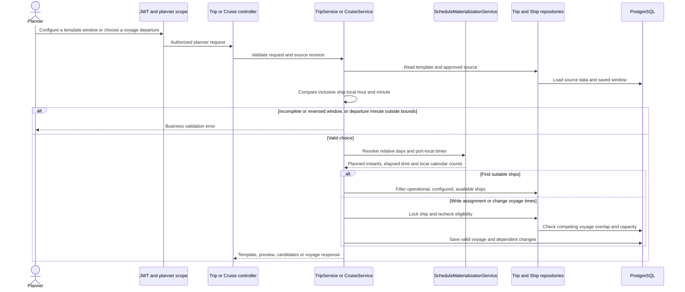

# Departure window, duration and fleet eligibility

Template create, update and draft patch accept an optional pair of inclusive `HH:mm` bounds in the ship timezone (`Asia/Ho_Chi_Minh`). Legacy offset timestamps are converted to the ship clock. Dates, seconds and fractions are discarded for window comparison. Trip list, detail, clone and archive responses and eligible-source list and detail return the bounds as `HH:mm`. Omitting both bounds preserves an existing window on update; supplying only one or reversing the bounds returns `TRIP_DEPARTURE_WINDOW_INVALID`. Equal bounds allow a single minute.

PostgreSQL stores the bounds as minute-aligned local times. Migration V136 converts legacy timestamps in the ship timezone and orders any legacy pair whose clock endpoints reverse after conversion. Source fingerprints computed after the change include the normalized bounds.

Schedule preview, eligible ships, cruise creation and materialization, draft updates, change preview/apply and delay preview/apply enforce the same window. A departure outside the window produces `DEPARTURE_OUTSIDE_TRIP_WINDOW` in validation errors and delay blockers, and a window-specific message in impact preview. The actual departure and return, stop timings, ship availability and overlap checks continue to use full instants. Voyage elapsed seconds are separate from local days and midnights in the departure-port timezone.

New voyages require a positive passenger count. Both passenger field names are accepted. A voyage can be created before ship assignment. Search and assignment exclude unconfigured ships; mutating paths lock the ship and recheck availability, including date changes with the same ship.
