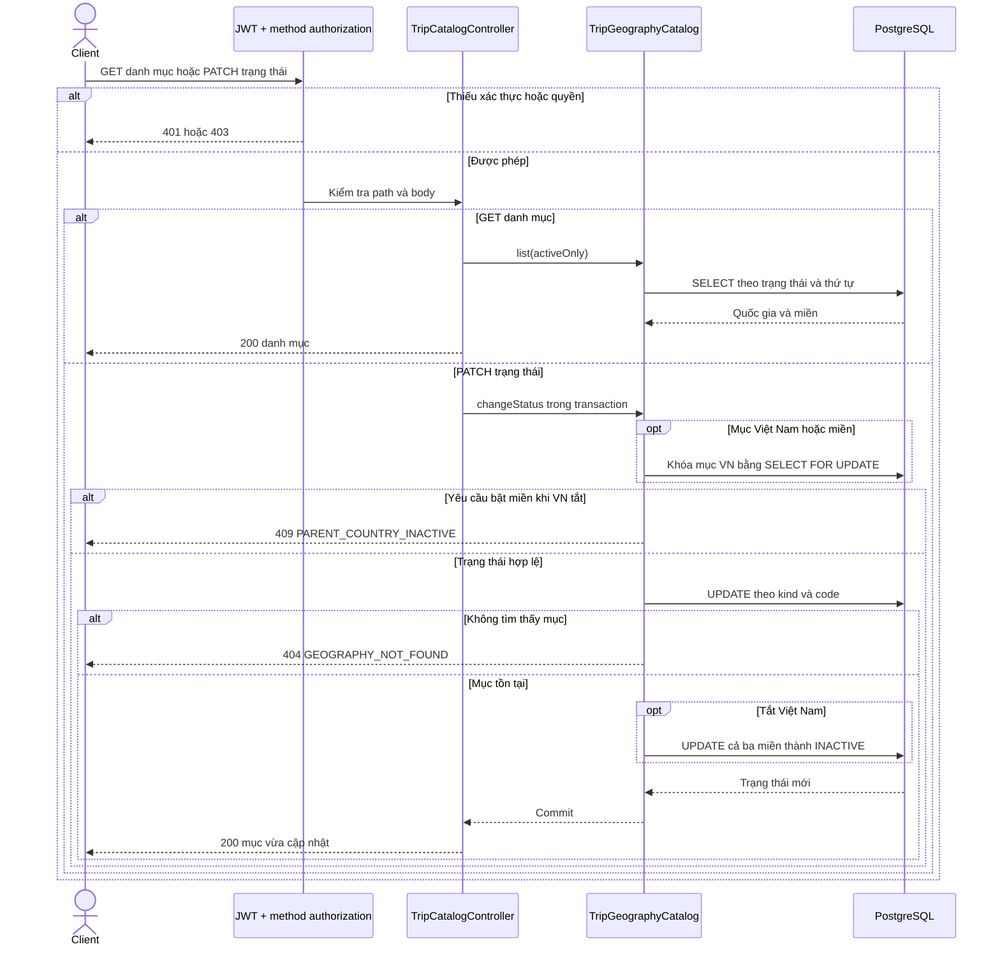
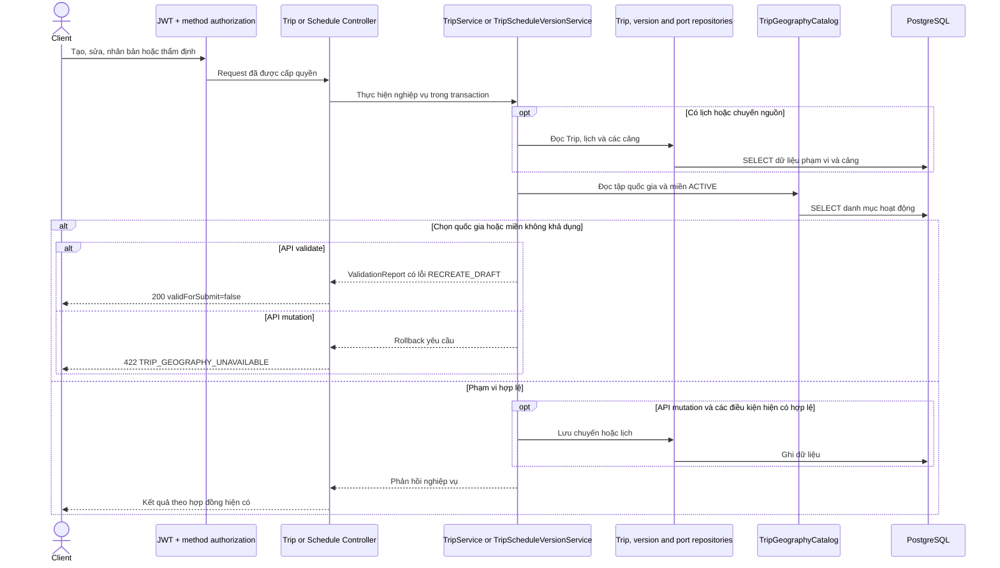

# Danh mục địa lý lập chuyến

## Danh mục chọn và cấu hình

Flyway V122 khởi tạo năm quốc gia và ba miền theo thứ tự đã công bố. Endpoint lập kế hoạch giữ cấu trúc `countries` và `domesticRegions`. Admin đọc cả trạng thái ACTIVE và INACTIVE từ endpoint cấu hình. Bật lại Việt Nam cho phép bật từng miền riêng.

## Tạo chuyến và lịch nháp

Việc đánh giá địa lý áp dụng cho thao tác lập kế hoạch mới và lịch nháp. Lịch đã phát hành tiếp tục đọc từ dữ liệu hiện có. Danh mục cảng dùng các bộ lọc cũ và thêm điều kiện quốc gia, miền đang hoạt động.

