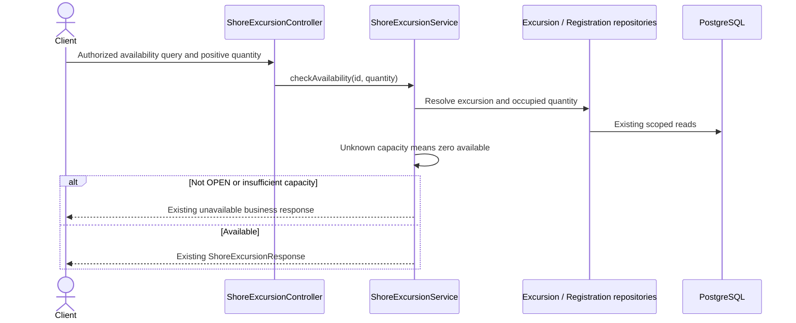

# GET /shore-excursions/{id}/availability

```mermaid
sequenceDiagram
    title GET /shore-excursions/{id}/availability — ShoreExcursionController.checkAvailability
    actor Client
    participant Security as Spring Security / JWT filters
    participant Controller as ShoreExcursionController
    participant Service as Resolved application service
    participant Repository as Repository collaborators
    participant DB as Database

    Client->>Security: GET /shore-excursions/{id}/availability + request
    alt Authentication or authorization rejected
        Security-->>Client: 401 / 403
    else Request reaches handler
        Security->>Controller: invoke checkAvailability(...)
        opt Bean validation when handler parameter has @Valid
            Controller->>Controller: Validate request constraints
        end
        Controller->>Service: shoreExcursionService.checkAvailability()

    Note over Controller,Service: Source branch: if excursion.getStatus(
    Note over Controller,Service: Source branch: if requestedParticipants <= 0
        Note over Service,Repository: @Transactional present on traced service method. Static trace covers direct service body and immediate helper branches; deeper call paths may need review.
        Note over Controller,Repository: No direct repository interaction found in traced method body
        Service-->>Controller: Domain result
        Controller-->>Client: HTTP response (verify DTO and status)
    Note over Service,Client: Source throws IllegalArgumentException; HTTP mapping requires exception-handler review
    Note over Service,Client: Source throws IllegalStateException; HTTP mapping requires exception-handler review
    end
```

## CASMS-75 behavior change

A PLANNED occurrence may have unknown capacity. Availability treats unknown capacity as zero and keeps the existing unavailable business response instead of unboxing null (500). Only OPEN occurrences with sufficient capacity can be available. Request constraints, EXCURSION_READ, registered quantity and response contract remain. Delta reviewed; older baseline is not newly certified. See [shared program flow](../ITINERARY-PROGRAM-FLOWS.md).


