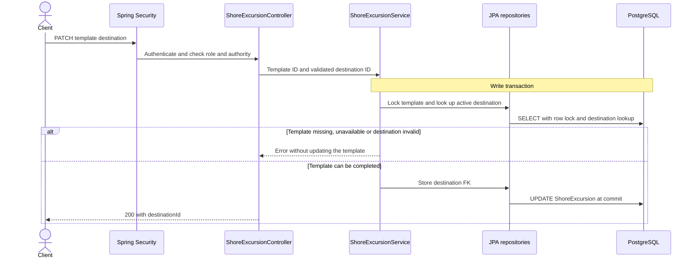

# PATCH /shore-excursions/definitions/{id}/destination

`ACTIVITY_SERVICE_MANAGER` with `EXCURSION_UPDATE` provides a required `destinationId` to complete a legacy planned template. Success returns the updated definition. Repeating the same assignment is safe. A different existing destination causes a conflict.

