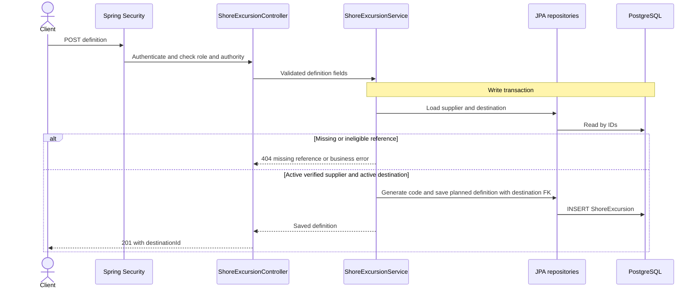

# POST /shore-excursions/definitions

`ACTIVITY_SERVICE_MANAGER` with `EXCURSION_CREATE` creates a planned template. Input requires `name`, `supplierId`, `meetingPoint` and `destinationId`. HTTP 201 includes the stored `destinationId` in `data`.

