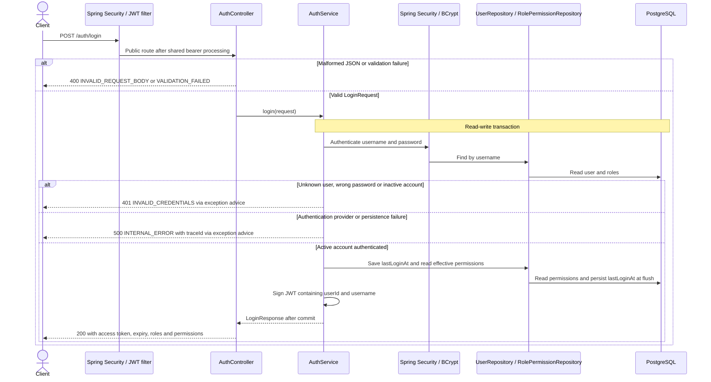

# POST /auth/login

Username is limited to 100 Unicode code points. Passwords are limited to 72 UTF-8 bytes. A persistence or commit failure is handled by auth-specific exception advice. The shared bearer and unexpected error handling is described in the [security flow](../README.md#shared-security-and-error-flow).
