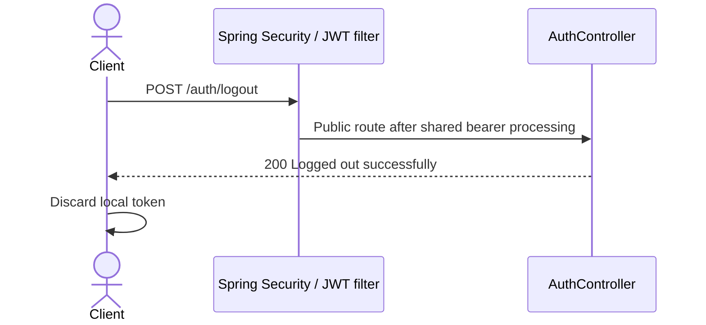

# POST /auth/logout

The controller has no transaction or token store. A valid token can still be used until expiration while the account remains active. Bearer authentication failures follow the [shared security flow](../README.md#shared-security-and-error-flow).
