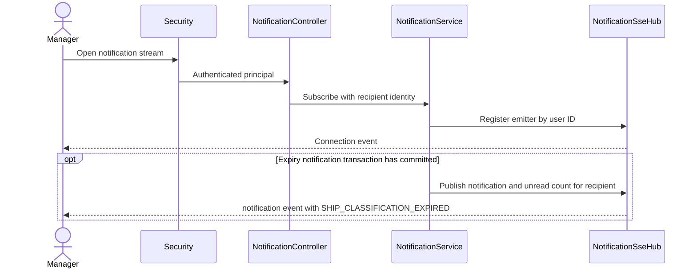

# GET /notification/stream

Uses the existing recipient-scoped SSE flow. The subscription does not open a database transaction. See [automatic maintenance](../SHIP-TYPE-FLOWS.md#automatic-maintenance-for-classification-expiry) for persistence and deduplication.
