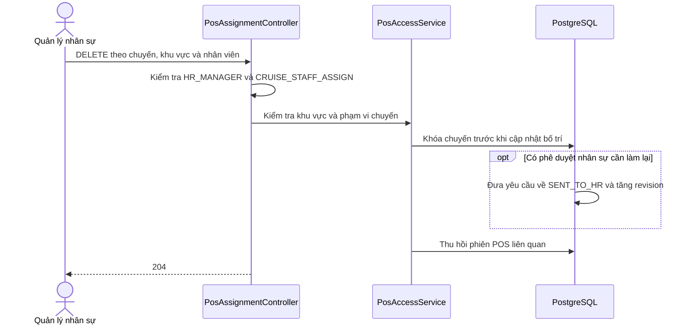

# DELETE `/ships/{shipId}/areas/{areaId}/staff/{userId}`

### Ảnh hưởng của luồng bàn giao nhân sự

Khi dữ liệu bố trí theo khu vực thay đổi sau lần gửi HR, trigger PostgreSQL vô hiệu hóa kết quả duyệt đang có của yêu cầu mới và đưa yêu cầu về chờ HR bố trí lại.

[Luồng kiểm tra và bàn giao](../SHIP-STAFFING-HANDOFF.md).

