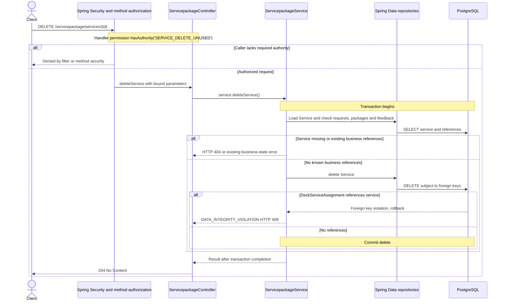

# DELETE /servicepackage/services/{id}

Deck persistence change reviewed against implementation on 2026-10-29. Paths are relative to `/api`.

The association never cascades deletion of a catalogue service. Remove deck assignments first. Existing SERVICE_DELETE_UNUSED permission remains unchanged.

