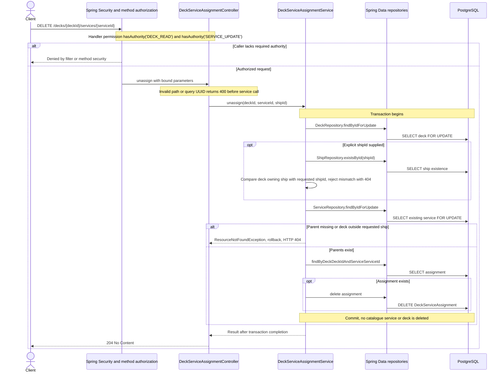

# DELETE /decks/{deckId}/services/{serviceId}

CASMS-90 reviewed against implementation on 2026-10-29. Paths are relative to `/api`; optional `shipId` scopes the physical deck.

Idempotent when the assignment is absent and both parents still exist.

