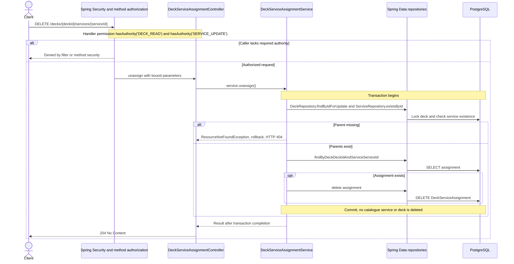

# DELETE /decks/{deckId}/services/{serviceId}

Deck persistence change reviewed against implementation on 2026-10-29. Paths are relative to `/api`.

Idempotent when the assignment is absent and both parents still exist.

