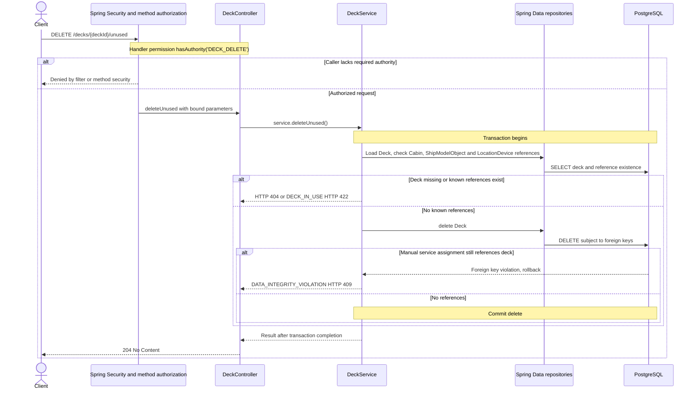

# DELETE /decks/{deckId}/unused

Deck persistence change reviewed against implementation on 2026-10-29. Paths are relative to `/api`.

Unassign services before deleting an unused deck. No cascade removes catalogue services or assignments.

