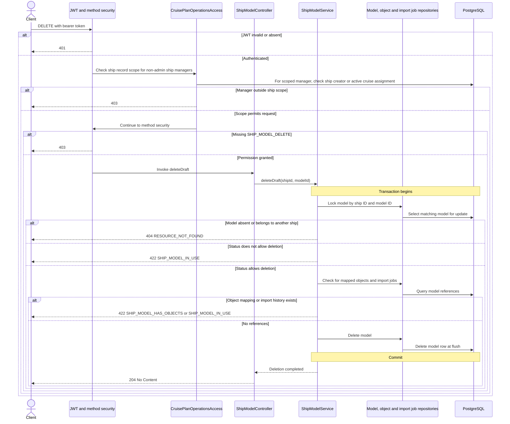

# DELETE /ships/{shipId}/models/{modelId}/unused

The endpoint removes a ship-specific model record. Registered asset bundles are shared and remain available.

The role initializer grants `SHIP_MODEL_DELETE` to `SHIP_MANAGER` at startup. A ship manager without the admin role can delete only a `DRAFT`. Other authorized actors may also delete a `FAILED` model. Refusals in the service roll back the transaction and the global exception handler serializes the error.
