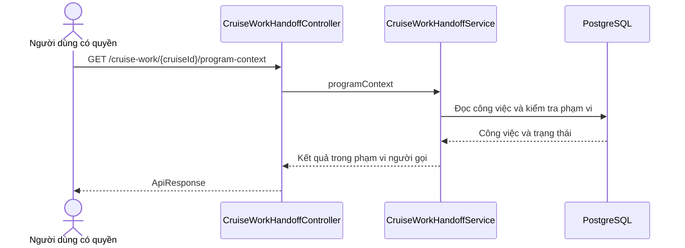

# GET `/cruise-work/{cruiseId}/program-context`

Người được giao ASM đọc ngữ cảnh chương trình. Chỉ được chỉnh khi nhiệm vụ ở IN_PROGRESS theo kiểm tra mayConfigurePrograms.

[Xem luồng bàn giao đầy đủ](../SHIP-STAFFING-HANDOFF.md).
