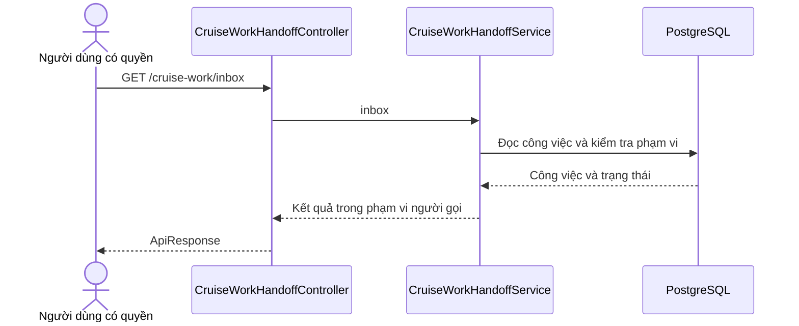

# GET `/cruise-work/inbox`

Hàng chờ ASM nhận các việc do luồng staffing khởi tạo. Công việc SHIP độc lập bị ẩn khi chuyến đang dùng bước kiểm tra tàu trong staffing.

[Xem luồng bàn giao đầy đủ](../SHIP-STAFFING-HANDOFF.md).
