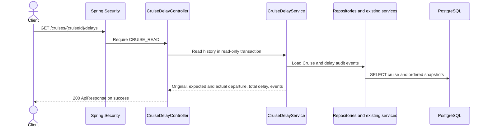

# GET /cruises/{cruiseId}/delays

CRUISE_READ. See [departure and delay flows](../CRUISE-DEPARTURE-DELAY.md).

## Ship schedule and fleet

See the [reviewed flow](../TRIP-DEPARTURE-WINDOW.md) for authorization, validation, transaction boundaries and responses. This note covers the BE-09 to BE-20 change.
