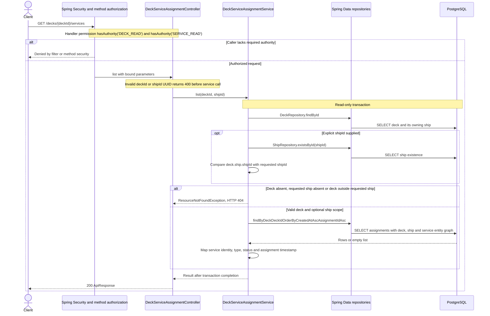

# GET /decks/{deckId}/services

CASMS-90 reviewed against implementation on 2026-10-29. Paths are relative to `/api`; optional `shipId` scopes the physical deck.

GET `/decks/**` passes the route matcher, but both DECK_READ and SERVICE_READ are still mandatory at method security.

