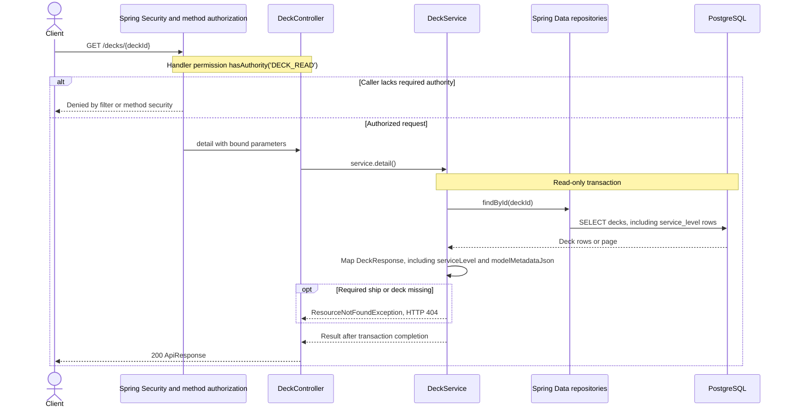

# GET /decks/{deckId}

Deck persistence change reviewed against implementation on 2026-10-29. Paths are relative to `/api`.

All physical levels have deckId UUIDs. modelMetadataJson preserves source deck fields; it does not create services.

