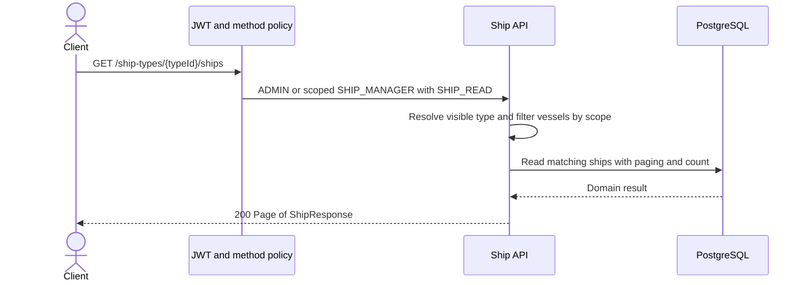

# GET /ship-types/{typeId}/ships

See [the WebAdmin contract](../../ship-redesign/CASMS_SHIP_BE_HANDOFF_FOR_FE.md) for request parameters, response fields, and errors.

The ShipResponse returns the stored commissionDate for newly provisioned typed ships.
