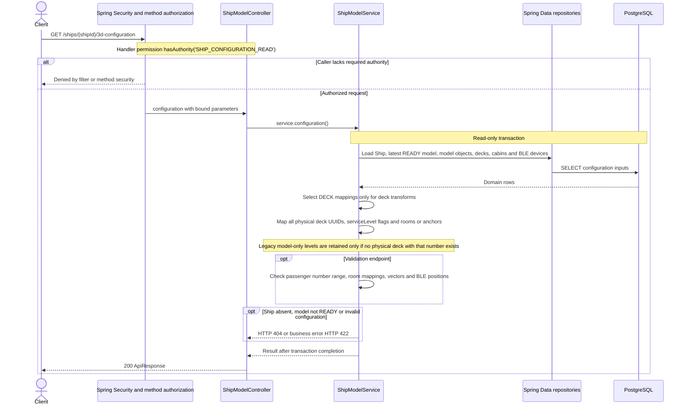

# GET /ships/{shipId}/3d-configuration

Deck persistence change reviewed against implementation on 2026-10-29. Paths are relative to `/api`.

Service level codes retain the SERVICE_number convention. No services are inferred from model areas. Deck-service assignments are queried through the dedicated deck API.

