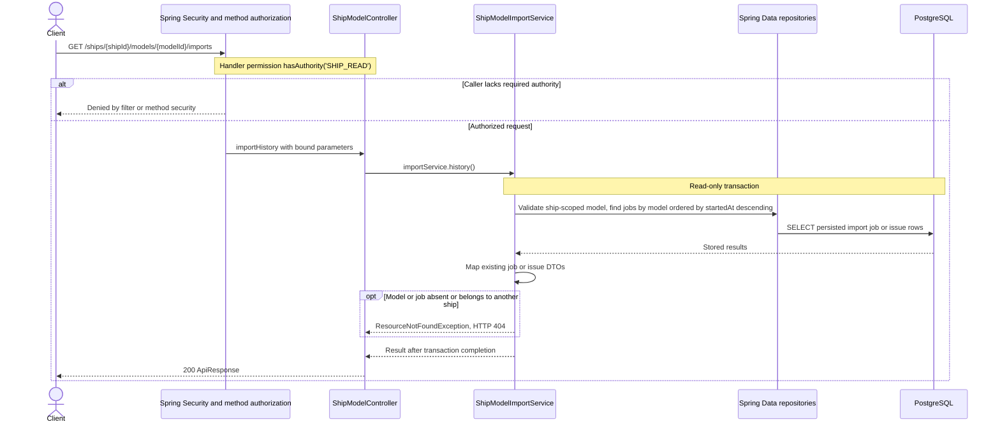

# GET /ships/{shipId}/models/{modelId}/imports

Deck persistence change reviewed against implementation on 2026-10-29. Paths are relative to `/api`.

Job counters include real passenger and technical Deck imports. Validation issues distinguish invalid service-deck numbering, metadata mismatch and deck classification conflicts. Ignored service objects are not failed imports. History is not a live database recount.

