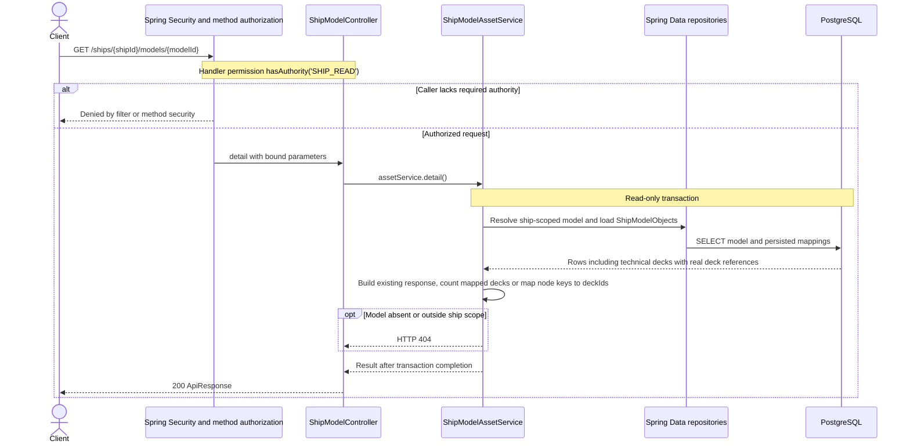

# GET /ships/{shipId}/models/{modelId}

Deck persistence change reviewed against implementation on 2026-10-29. Paths are relative to `/api`.

Model detail now includes serviceDecks as linked deck rows after reimport. Existing manifest and model scope validation still applies.

