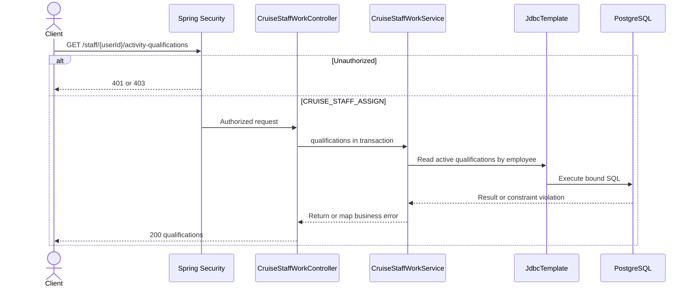

# GET /staff/{userId}/activity-qualifications

See the [shared work scheduling flow](../ITINERARY-PROGRAM-FLOWS.md#dịch-vụ-và-ca-hoạt-động).

## HR assignment lifecycle

Admin account qualification records are excluded from results. See [assignment lifecycle](../ITINERARY-PROGRAM-FLOWS.md#một-chuyến-đang-hiệu-lực-cho-mỗi-nhân-viên).
