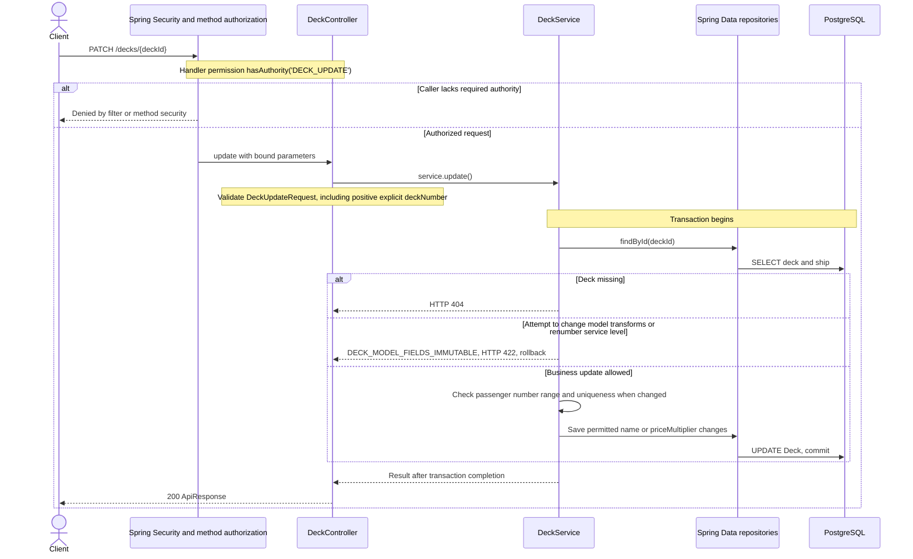

# PATCH /decks/{deckId}

Deck persistence change reviewed against implementation on 2026-10-29. Paths are relative to `/api`.

Non-positive technical numbering is set by model import. This PATCH does not convert a technical deck into a passenger deck or modify its model geometry.

