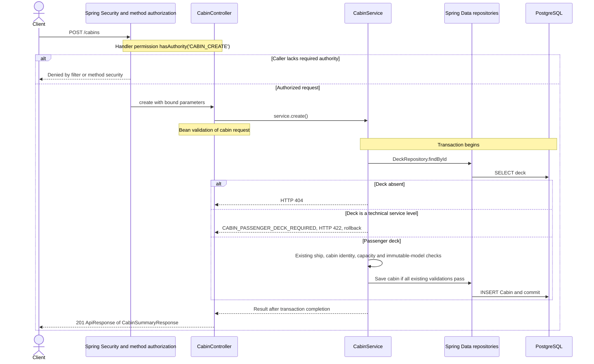

# POST /cabins

Deck persistence change reviewed against implementation on 2026-10-29. Paths are relative to `/api`.

The new technical deck rows must not relax the existing invariant that passenger cabins belong to positive passenger decks.

