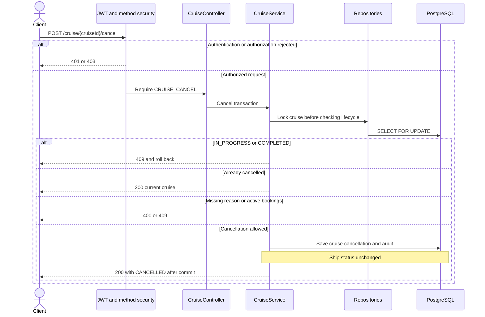

# POST /cruise/{cruiseId}/cancel

The cruise row lock prevents a cancellation from overwriting a concurrent start. After start commits, this endpoint rejects the status as IN_PROGRESS. Cancellation leaves the ship's status unchanged.

## HR assignment lifecycle

When Cruise becomes CANCELLED, V100 closes ACTIVE staff rows as CANCELLED in the same transaction. See [assignment lifecycle](../ITINERARY-PROGRAM-FLOWS.md#một-chuyến-đang-hiệu-lực-cho-mỗi-nhân-viên).
