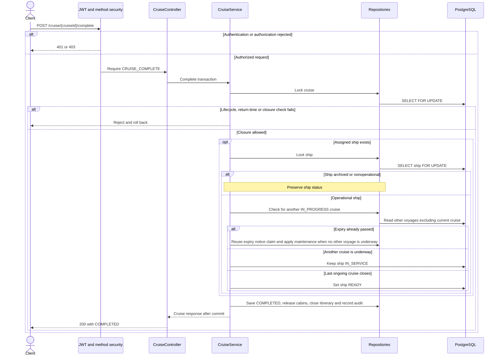

# POST /cruise/{cruiseId}/complete

Ship and voyage changes commit together. An operational ship can return to READY on the expiry date or when a legacy profile has no known expiry. A known date before the current Vietnam date uses the [classification expiry flow](../SHIP-TYPE-FLOWS.md#automatic-maintenance-for-classification-expiry), with at most one manager notice per ship and expiry date.

## HR assignment lifecycle

When Cruise becomes COMPLETED, V100 closes ACTIVE staff rows in the same transaction and preserves history. Those employees become eligible for new assignments. See [assignment lifecycle](../ITINERARY-PROGRAM-FLOWS.md#một-chuyến-đang-hiệu-lực-cho-mỗi-nhân-viên).
