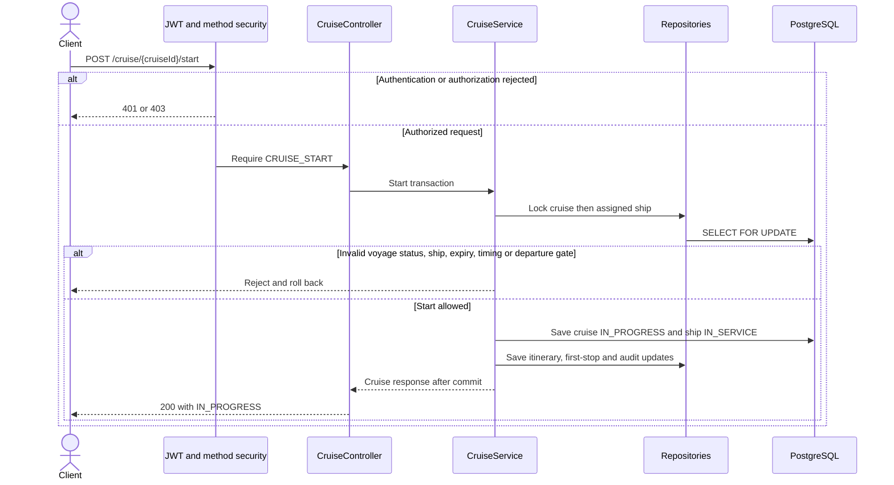

# POST /cruise/{cruiseId}/start

Start locks the Cruise row before evaluating lifecycle and departure readiness so it serializes with delay confirmation. See [departure and delay flows](../CRUISE-DEPARTURE-DELAY.md).

Start also locks the assigned ship row before changing the cruise to IN_PROGRESS. It checks operational status and, when an expiry is recorded, checks it against the later of today's date and planned return date in Vietnam. Expiry before that date returns 422. The scheduled [classification expiry check](../SHIP-TYPE-FLOWS.md#automatic-maintenance-for-classification-expiry) takes the same ship lock before checking whether a voyage is IN_PROGRESS.

When the departure gate succeeds, the write transaction marks the ship IN_SERVICE and the cruise IN_PROGRESS together. The response continues to describe the cruise.

### Kiểm tra tàu và bố trí nhân sự

Khi nhánh xử lý gọi kiểm tra chuẩn bị vận hành, yêu cầu nhân sự mới phải được vận hành duyệt và vẫn đáp ứng điều kiện về tàu, POS, định mức dịch vụ, khu vực và hoạt động. Kết quả còn thiếu được phản ánh qua kiểm tra staffing của bước hiện tại. [Luồng kiểm tra và bàn giao](../SHIP-STAFFING-HANDOFF.md).
