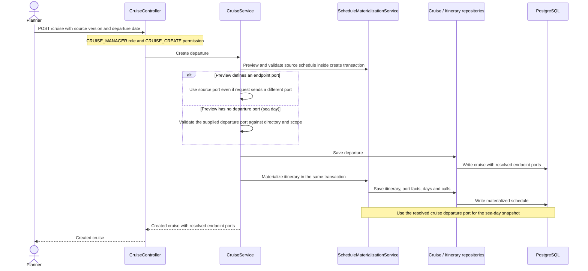

# POST /cruise

Khi có `shipId`, service khóa tàu và kiểm tra hạn đăng kiểm đến ngày về theo giờ Việt Nam. Chuyến từ lịch nguồn dùng thời điểm về đã chiếu. Chuyến thủ công dùng thời điểm về đã kiểm tra từ yêu cầu. Thiếu hạn hoặc hạn trước ngày về trả 422. Tạo nháp chưa gán tàu không chạy bước này.

```mermaid
sequenceDiagram
    title POST /cruise — CruiseController.create
    actor Client
    participant Security as Spring Security / JWT filters
    participant Controller as CruiseController
    participant Service as Resolved application service
    participant Repository as Repository collaborators
    participant DB as Database

    Client->>Security: POST /cruise + request
    alt Authentication or authorization rejected
        Security-->>Client: 401 / 403
    else Request reaches handler
        Security->>Controller: invoke create(...)
        opt Bean validation when handler parameter has @Valid
            Controller->>Controller: Validate request constraints
        end
        Controller->>Service: idempotencyService.executeCruiseCreate()
        Controller->>Service: service.create()

    Note over Controller,Service: Source branch: for int i = 0; i < maxAttempts; i++
    Note over Controller,Service: Source branch: if !Set.of("FIXED", "CUSTOM").contains(mode)
    Note over Controller,Service: Source branch: if !ShipStatus.isOperational(ship.getStatus())
    Note over Controller,Service: Source branch: if !legacyHash.equals(requestHash)
    Note over Controller,Service: Source branch: if actorId == null || key == null || key.isBlank()
    Note over Controller,Service: Source branch: if atomicCruise
    Note over Controller,Service: Source branch: if cruise.getCompletionActor() != null
    Note over Controller,Service: Source branch: if cruise.getDepartureActor() != null
    Note over Controller,Service: Source branch: if cruise.getDeparturePort() != null
    Note over Controller,Service: Source branch: if cruise.getOpenedForSaleBy() != null
    Note over Controller,Service: Source branch: if cruise.getReturnPort() != null
    Note over Controller,Service: Source branch: if cruise.getShip() != null
        Note over Service,Repository: @Transactional present on traced service method. Static trace covers direct service body and immediate helper branches; deeper call paths may need review.
        opt Repository interactions found in traced handler/service code
            Service->>Repository: CruiseRepository.existsOverlappingCruises()
            Service->>Repository: CruiseRepository.save()
            Repository->>DB: Database operation via repository
            DB-->>Repository: Result / persistence outcome
            Repository-->>Service: Result (caller may be Controller for inline repository use)
        end
        Service-->>Controller: Domain result
        Controller-->>Client: HTTP response (verify DTO and status)
    Note over Service,Client: Source throws BusinessException; HTTP mapping requires exception-handler review
    end
```


Changed branches for adjacent port identity, terminal role and time checks are reviewed in [Port call sequence](../PORT-CALL-SEQUENCE.md). This addendum does not certify the static trace for unrelated behavior.

Materialization applies the offset from template departure LocalTime to chosen Cruise departure to port calls and operational programs in the create transaction. See [departure and delay flows](../CRUISE-DEPARTURE-DELAY.md).

## Ship schedule and fleet

See the [reviewed flow](../TRIP-DEPARTURE-WINDOW.md) for authorization, validation, transaction boundaries and responses. This note covers the BE-09 to BE-20 change.

Voyage departure window validation compares the ship-local departure minute against the template bounds. See the [departure window flow](../TRIP-DEPARTURE-WINDOW.md).

## Shore excursion destination

When applying a schedule or synchronizing its programs, materialization verifies the destination of the exact port call and checks that referenced tours are planned templates tied to that destination. An unlinked, mismatched or ineligible existing template raises a 422 and rolls back the operation. A missing source or supplier produces a failed mapping without a tour. See [the reviewed flow](../ITINERARY-PROGRAM-FLOWS.md#shore-excursion-template-selection).

### Source port inheritance



Validation or materialization failure aborts creation. Inherited stops stay in their scheduled order. Cruise list/detail use the resolved port IDs, while schedule reads and operational validation use the materialized departure port facts.
