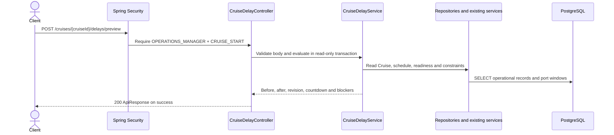

# POST /cruises/{cruiseId}/delays/preview

OPERATIONS_MANAGER + CRUISE_START. See [departure and delay flows](../CRUISE-DEPARTURE-DELAY.md).

## Ship schedule and fleet

See the [reviewed flow](../TRIP-DEPARTURE-WINDOW.md) for authorization, validation, transaction boundaries and responses. This note covers the BE-09 to BE-20 change.

### Kiểm tra tàu và bố trí nhân sự

Khi nhánh xử lý gọi kiểm tra chuẩn bị vận hành, yêu cầu nhân sự mới phải được vận hành duyệt và vẫn đáp ứng điều kiện về tàu, POS, định mức dịch vụ, khu vực và hoạt động. Kết quả còn thiếu được phản ánh qua kiểm tra staffing của bước hiện tại. [Luồng kiểm tra và bàn giao](../SHIP-STAFFING-HANDOFF.md).

Voyage departure window validation compares the ship-local departure minute against the template bounds. See the [departure window flow](../TRIP-DEPARTURE-WINDOW.md).

The departure port facts used here come from [source port inheritance](post-cruise.md#source-port-inheritance) for newly materialized cruises. When the source has no departure port, the facts are captured from the chosen departure port.
