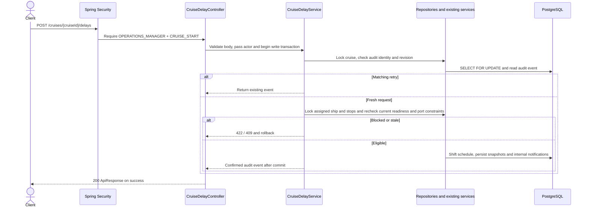

# POST /cruises/{cruiseId}/delays

OPERATIONS_MANAGER + CRUISE_START. See [departure and delay flows](../CRUISE-DEPARTURE-DELAY.md).

See [CASMS-75 catalog and staffing flows](../CASMS75-CATALOG-STAFFING-FLOWS.md) for the shared integration behavior.
