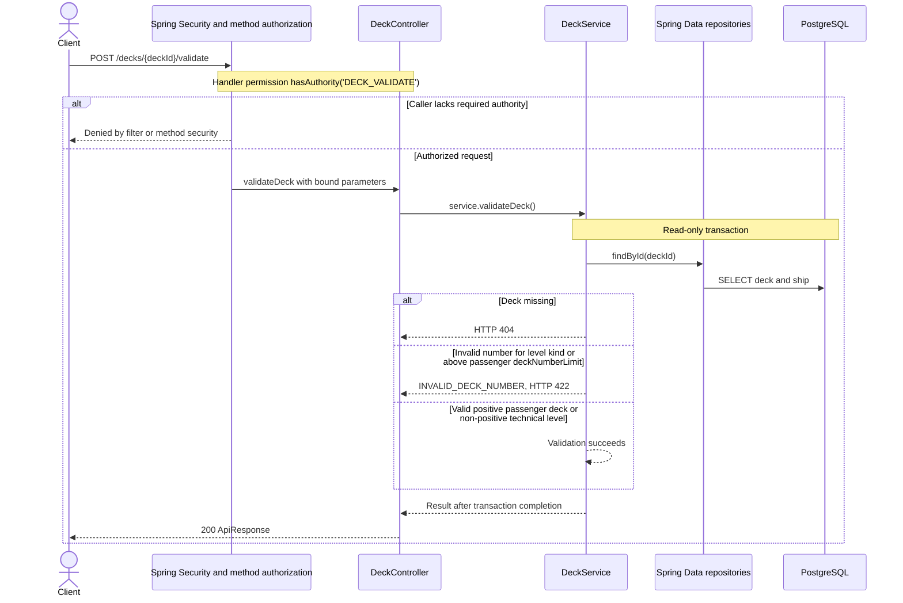

# POST /decks/{deckId}/validate

Deck persistence change reviewed against implementation on 2026-10-29. Paths are relative to `/api`.

Uses ship.deckNumberLimit when present, with totalDecks fallback; a skipped passenger number does not imply too many decks.

