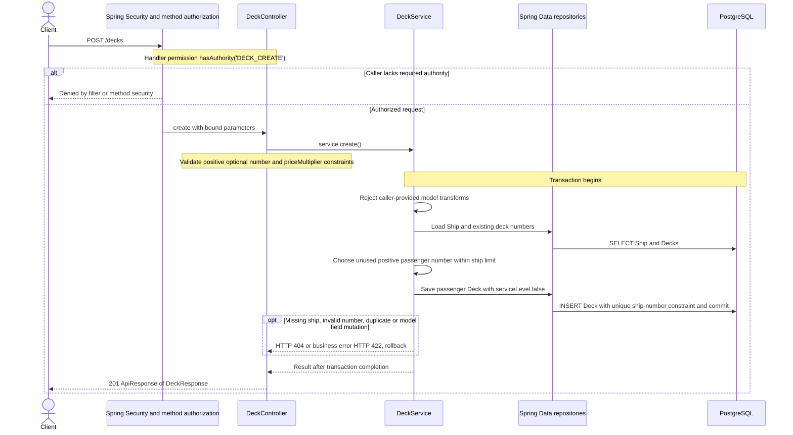

# POST /decks

Deck persistence change reviewed against implementation on 2026-10-29. Paths are relative to `/api`.

Manual deck creation remains restricted to passenger decks. Technical deck numbers come from model import; the response includes serviceLevel and nullable modelMetadataJson.

