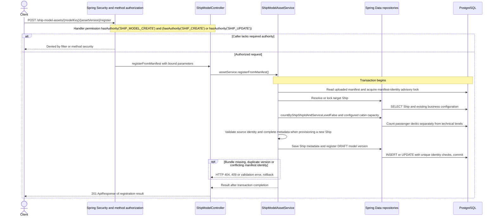

# POST /ship-model-assets/{modelKey}/{assetVersion}/register

Deck persistence change reviewed against implementation on 2026-10-29. Paths are relative to `/api`.

Registration preserves existing authority checks; manifest provisioning checks SHIP_CREATE for new ships and SHIP_UPDATE for existing ones. Technical levels do not inflate the passenger deckCount comparison.

