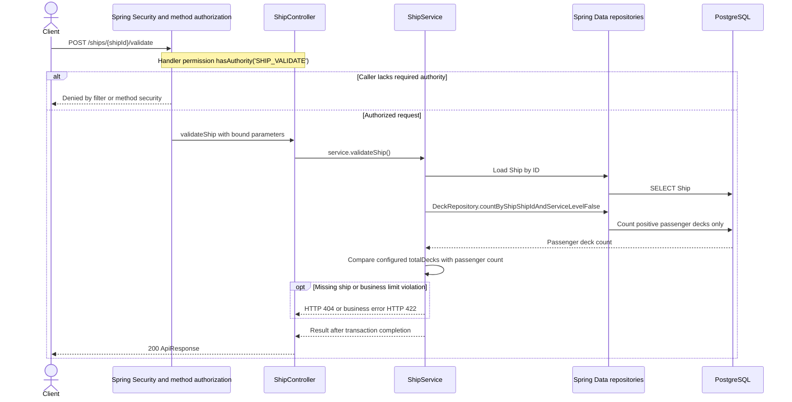

# POST /ships/{shipId}/validate

Deck persistence change reviewed against implementation on 2026-10-29. Paths are relative to `/api`.

For this change, only passenger-deck limit validation changes. Technical/service decks remain in ordinary listing and total physical counts. PATCH retains its existing checks and transactional field updates; validate is read-only. See ShipService for unrelated capacity and dimension checks.

