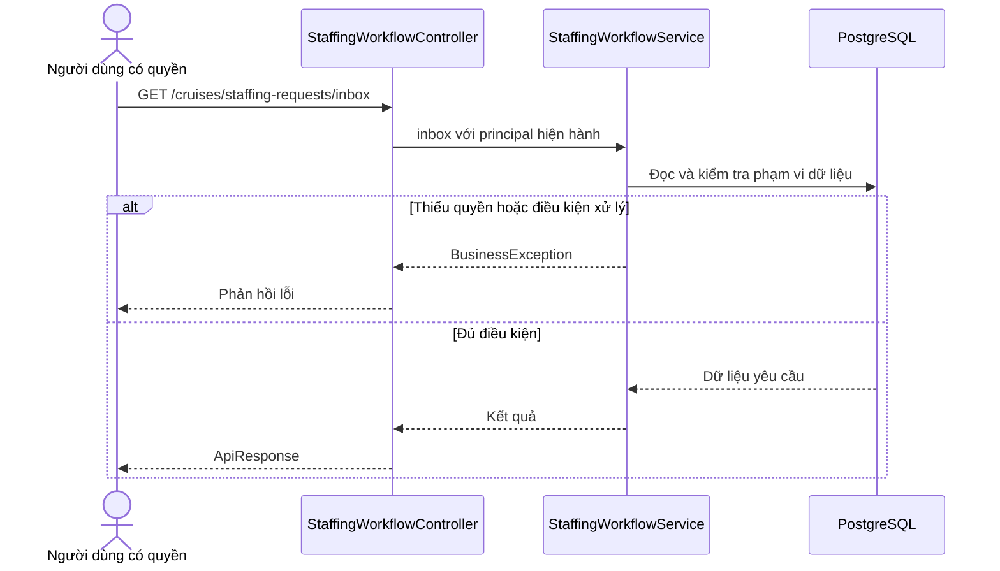

# GET `/cruises/staffing-requests/inbox`

Lọc hàng chờ theo vai trò, trạng thái và phạm vi chuyến. Quản lý tàu thấy cả yêu cầu kiểm tra ban đầu và yêu cầu rà soát HR. Vận hành thấy yêu cầu sau khi HR duyệt.

[Xem đầy đủ các bước bàn giao](../SHIP-STAFFING-HANDOFF.md).

### Bàn giao chương trình trước khi kiểm tra tàu

Quản lý tàu không thấy yêu cầu ở PENDING_ASM. Quản lý dịch vụ và hoạt động nhận việc qua GET /cruise-work/inbox.

[Xem luồng đầy đủ](../SHIP-STAFFING-HANDOFF.md).
