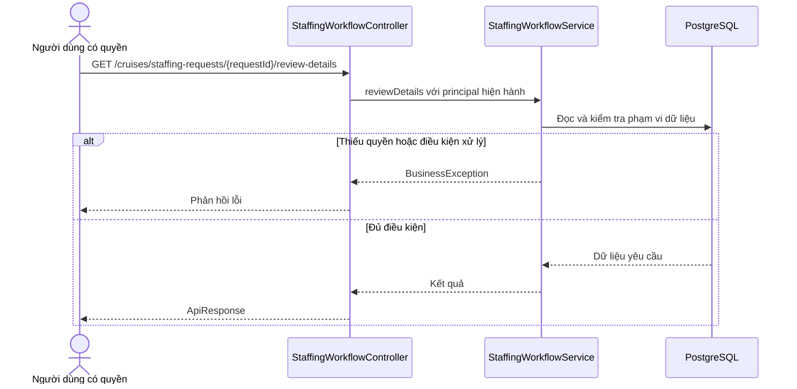

# GET `/cruises/staffing-requests/{requestId}/review-details`

Trong phạm vi yêu cầu, đọc tàu và cabin, liên kết POS theo khu vực, các khu vực và hoạt động thiếu bố trí, danh sách phân công theo từng nhân viên.

[Xem đầy đủ các bước bàn giao](../SHIP-STAFFING-HANDOFF.md).

### Bàn giao chương trình trước khi kiểm tra tàu

Chi tiết phục vụ bố trí: dịch vụ trên tàu của chuyến, khu vực phục vụ, máy POS phù hợp và độ phủ từng dịch vụ. Chương trình tại cảng không được dùng làm đầu vào gắn POS.

[Xem luồng đầy đủ](../SHIP-STAFFING-HANDOFF.md).
