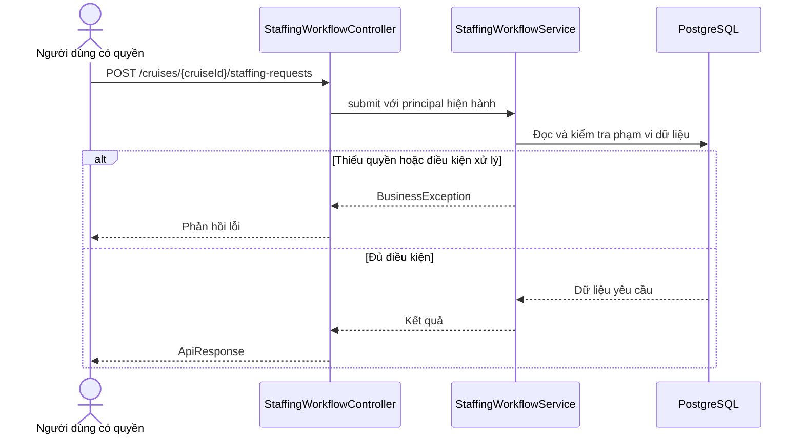

# POST `/cruises/{cruiseId}/staffing-requests`

Quản lý lịch trình phụ trách gửi revision lịch trình và các định mức dịch vụ. Giao dịch khóa chuyến, kiểm tra điều kiện và lưu yêu cầu ở PENDING_SHIP_REVIEW cùng lịch sử.

[Xem đầy đủ các bước bàn giao](../SHIP-STAFFING-HANDOFF.md).

### Bàn giao chương trình trước khi kiểm tra tàu

Giao việc ASM hoặc dùng lại phần chương trình đã hoàn tất. Yêu cầu chưa hoàn tất chương trình ở PENDING_ASM và xuất hiện cho quản lý tàu sau khi chương trình đạt.

[Xem luồng đầy đủ](../SHIP-STAFFING-HANDOFF.md).
