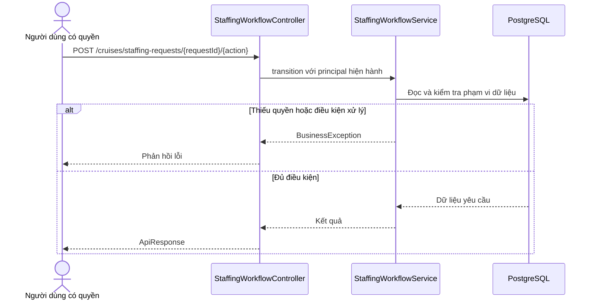

# POST `/cruises/staffing-requests/{requestId}/{action}`

Xác nhận hoặc trả lại theo trạng thái và vai trò. Khóa chuyến và yêu cầu, kiểm tra revision, cập nhật trạng thái và ghi audit trong cùng giao dịch. Xem sơ đồ tổng thể để biết từng nhánh và thời điểm gửi thông báo.

[Xem đầy đủ các bước bàn giao](../SHIP-STAFFING-HANDOFF.md).

### Bàn giao chương trình trước khi kiểm tra tàu

SHIP_CHECKED kiểm tra POS theo khu vực và liên kết cho các dịch vụ trên tàu đã lên chương trình. Nếu thiếu độ phủ, không chuyển trạng thái và không gửi thông báo. Nếu đủ, chuyển SENT_TO_HR và ghi thông báo cho quản lý chuyến trong cùng giao dịch.

[Xem luồng đầy đủ](../SHIP-STAFFING-HANDOFF.md).
