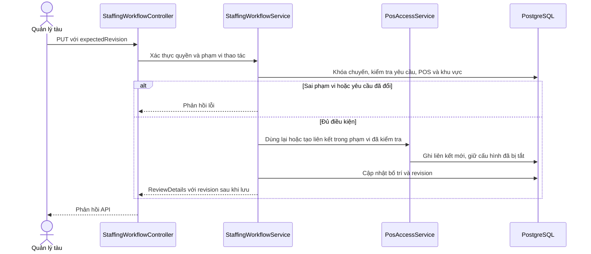

# PUT `/cruises/staffing-requests/{requestId}/area-pos/{areaId}`

Gắn POS vào khu vực phục vụ, kể cả khu vực chưa được chọn để bố trí một dịch vụ của chuyến. Yêu cầu phải đang chờ quản lý tàu và có revision hiện hành. Liên kết được quản trị viên tắt trả lỗi 409.

[Xem luồng bàn giao đầy đủ](../SHIP-STAFFING-HANDOFF.md).
