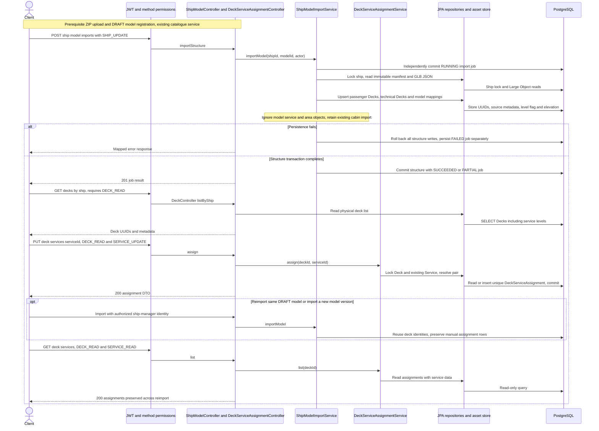

# Import decks and assign catalogue services

Reviewed against the changed import, asset, deck and assignment services on 2026-10-29. All HTTP paths use the `/api` context. Each endpoint retains its own permission checks; the client may use separate ship-manager and service-manager identities.

Foreign keys protect referenced decks and services. Removing an assignment deletes only the relationship. This flow does not activate services, create prices or change model publication rules.
