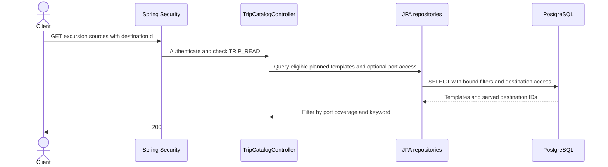

# GET /trip-planning/catalogs/sources/excursions

Requires `TRIP_READ`. The tour picker uses `destinationId` to restrict the list to planned templates for the chosen active destination. The optional `portId` limits results through `PortDestinationAccess`. Legacy templates missing a destination and scheduled occurrences are excluded.

