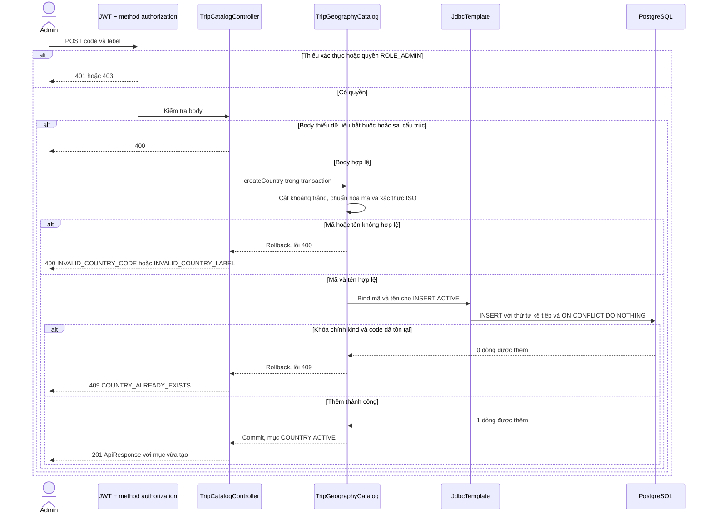

# POST /trip-planning/catalogs/geography/countries

Quốc gia đã tồn tại giữ nguyên tên và trạng thái khi yêu cầu tạo trùng. Quốc gia mới xuất hiện trong danh mục hoạt động sau khi commit. Xem [luồng danh mục địa lý](../TRIP-GEOGRAPHY-FLOWS.md) để đối chiếu các API đọc và thay đổi trạng thái.
