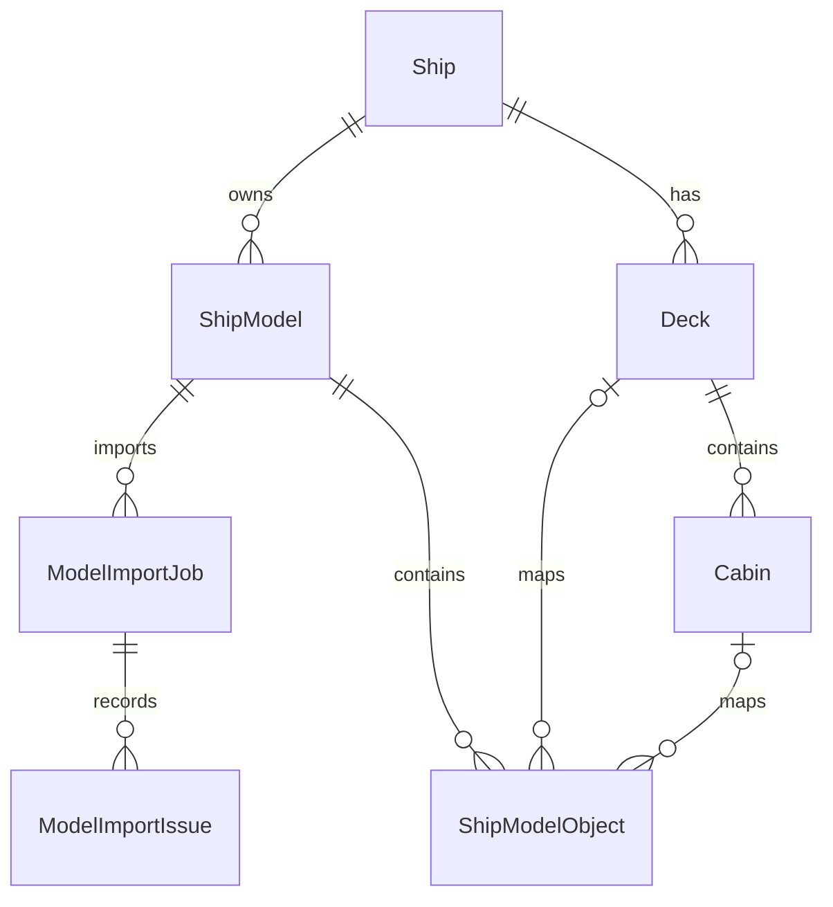

# Sprint 1 Backend: 3D Ship Model Import Audit

**Date:** 2026-10-23
**Repository:** `CASMS_Backend`
**Base / working branch:** `main` → `feature/CASMS-86-3d-ship-model-import`
**Working tree before implementation:** clean; no existing developer edits were present.
**Scope:** backend and database only. No frontend source was available in this repository or modified.

## A. Current backend state

The backend is a Spring Boot 3.3.4 / Java 21 application using Spring MVC, Spring Security, Spring Data JPA, PostgreSQL, Flyway, and Jackson. Model assets are stored as PostgreSQL Large Objects in `ShipModelAssetBlob`; the bundle service already checks ZIP paths, checksums, GLB v2 headers, manifest shape, and listed asset presence. A registered asset is represented by `ShipModel` and has `DRAFT`, `READY`, or `ARCHIVED` lifecycle status.

Before this change, APIs could upload/register bundles, serve assets, return asset metadata, and replace deck/cabin mappings to pre-existing CASMS records. Registering a bundle did not read its GLB node hierarchy or import deck/cabin records. `ShipModelObject` already provided a unique `(ship_model_id, node_key)` model-node mapping. `Deck` and `Cabin` were already business entities with ship/deck relationships and model transform columns.

No frontend repository was present next to this checkout. The repo contains no additional GLB parsing library; the implementation adds a bounded GLB JSON-chunk reader using the existing Jackson/PostgreSQL Large Object stack, with no new dependency.

## B. Model inspection and data provenance

The committed v10 sample assets were inspected directly. Their full GLB JSON chunks were decoded locally to inventory the hierarchy. The backend parser reads the JSON chunk from PostgreSQL Large Objects and cross-checks identifiers against `manifest.json`. The Zaandam v10 bundle was uploaded through the multipart API and imported against PostgreSQL in `ShipModelImportPostgresIntegrationTest`.

| Data | Verified source and sample result | Mapping / persistence |
|---|---|---|
| GLB format | `ship.glb` files have a GLB v2 header and contain JSON plus binary geometry | Parser checks version, declared file length, JSON chunk type, a 64 MiB JSON limit, and parses JSON via Jackson. It does not materialize mesh buffers. |
| Passenger decks | Zaandam: 10 (`zaandam-d01` … `zaandam-d10`); Conquest: 13 (`conquest-d01` … `conquest-d13`) | GLB `nodes[].extras` (`entityType=deck`, `modelId`, `deckNumber`, `deckName`, `elevation`) cross-checked against manifest `decks`; upsert existing `Deck` by `(ship_id, deck_number)`. |
| Service levels | Both manifests contain 2 model levels; GLB marks them `serviceDeck` (non-positive deck numbers) | Stored as `ShipModelObject` nodes without a business `Deck` FK because the existing Deck table enforces positive deck numbers. |
| Cabins | Zaandam: 291; Conquest: 305. GLB node counts agree with manifest. | Stable node key is `extras.modelId`; cabin number and deck relationship are cross-checked with GLB extras. Upsert `Cabin` by `(ship_id, cabin_number)` and persist the version-specific relation in `ShipModelObject`. |
| Cabin type | Model extras and manifest provide CASMS values. Zaandam: 170 ocean view, 30 interior, 80 balcony, 11 suite. Conquest: 96 ocean view, 100 interior, 106 balcony, 3 suite. | `CabinType.valueOf`; unsupported or missing types create an object-level issue rather than a guessed type. |
| Cabin capacity/accessibility/area | Present in the manifest and GLB cabin extras | Capacity and accessibility map to existing cabin columns; area and balcony area map to current columns. `AVAILABLE` is initialized using the same domain default as `CabinService.create`; this is not read from the model. |
| Position | GLB cabin node `translation` is present; manifest also carries a position | Uses GLB translation for `Cabin.model_position_*`; the source metadata is retained on the model mapping. No rotation is claimed where the sample node does not supply one. |
| Dimensions | Manifest cabin `size` array is present; dimensions are not inferred from mesh geometry by this parser | Maps to `Cabin.model_width/height/depth` and is also retained as compact source metadata in `ShipModelObject`. Geometry buffers are not copied into business tables. |
| Commercial identity/status | `manufacturer`, `origin`, `shipCode`, and operational `status` are absent from both inspected manifests | Not imported or inferred. Ship identity and operational state stay with existing CASMS ship workflows. |

The manifests identify the sample geometry as reference/custom layouts, including custom cabin renumbering; they do not prove that the layouts are the operational layout of a ship already in the database. Operators must choose the matching ship and registered model. The importer does not update the ship name, code, status, capacity, or configured total deck count.

## C. Entity and relationship inventory

### Existing entities retained

| Entity / table | Important fields and constraints | Relationships and lifecycle |
|---|---|---|
| `Ship` / `Ship` | UUID PK; unique `ship_code`; name, status, total capacity, total decks | Parent of `ShipModel`, `Deck`, and `Cabin`; imported structure never changes ship identity/status. |
| `ShipModel` / `ShipModel` | UUID PK; version, model key/version/revision, file URI/format, checksum, coordinate frame/unit/scale, status; unique `(ship_id, version)` and asset-key/version index | FK to `Ship`; registered through existing asset API, new import jobs reference it. |
| `ShipModelAssetBlob` / `ShipModelAssetBlob` | UUID PK; model key/version/path, PostgreSQL OID, byte size, SHA-256; unique `(model_key, asset_version, asset_path)` | Existing asset registry and unlink trigger remain unchanged. |
| `ShipModelObject` / `ShipModelObject` | UUID PK; node key, display name, type, JSON metadata, transform; unique `(ship_model_id, node_key)`, indexes on deck/cabin FK | FK to model and optional `Deck`/`Cabin`; now records imported nodes and binds their identities to business records. |
| `Deck` / `Deck` | UUID PK; ship FK, positive deck number, name, price multiplier, model transform; unique `(ship_id, deck_number)` | Parent of cabins; import uses existing rows or creates a row for a valid passenger deck. Schema is unchanged. |
| `Cabin` / `Cabin` | UUID PK; ship/deck FK, cabin number/type/capacity/status/accessibility, area, location and model transform; unique `(ship_id, cabin_number)` | Import uses the existing business entity and mapping; it does not delete rows absent from a newer manifest. Schema is unchanged. |

### New entities

| Entity / table | Purpose, fields, constraints | Relationships |
|---|---|---|
| `ModelImportJob` / `ModelImportJob` | UUID PK; status, start/finish, requesting username, object/deck/cabin success/failure/skip counts, summary error. Index `(ship_model_id, started_at DESC)`. Status constraint permits `RUNNING`, `SUCCEEDED`, `PARTIAL`, `FAILED`. | FK to `ShipModel`; one row per synchronous import attempt. Retrying creates a new job. |
| `ModelImportIssue` / `ModelImportIssue` | UUID PK; object identifier/type, error code, readable message, created time; indexed by job and creation time. | FK to `ModelImportJob`, cascade delete. Errors are returned through the issue API. |

### Verified relationship diagram

No separate `ModelAsset`, `ModelMapping`, or `ImportIssue` entity was added: existing `ShipModel`, `ShipModelObject`, and `ShipModelAssetBlob` already cover those responsibilities. New job and issue entities were added because no equivalent durable attempt history or per-object failure table existed.

## D. Changed files

| File | Change and effect |
|---|---|
| `src/main/java/com/casms/ship/service/ShipModelAssetStore.java` | Adds bounded GLB JSON-chunk reading from PostgreSQL Large Objects. Rejects invalid/truncated headers/chunks, non-v2 files, oversized JSON, and invalid JSON. Mesh buffers remain streamed/stored and are not loaded into memory. |
| `src/main/java/com/casms/ship/service/ShipModelImportService.java` | Adds synchronous manifest/GLB identity reconciliation, model-node mapping, positive passenger-deck and cabin upserts, per-object validation issues, ship-level pessimistic lock, and job history retrieval. Re-import updates rows addressed by existing business natural keys and retains absent objects. |
| `src/main/java/com/casms/ship/service/ModelImportJobLifecycle.java` | Commits job creation before import and records `FAILED` in an independent transaction after processing rollback; original processing exception is rethrown. Failure persistence still requires a reachable database. |
| `src/main/java/com/casms/ship/controller/ShipModelController.java` | Adds import, history, job detail, and issue endpoints using existing `SHIP_UPDATE` / `SHIP_READ` authorities and `ApiResponse`. |
| `src/main/java/com/casms/ship/service/CabinService.java` | Rejects normal cabin updates that include model-fixed type, position, rotation, or dimensions with `CABIN_MODEL_FIELDS_IMMUTABLE`. Capacity/accessibility remain editable. |
| `src/main/java/com/casms/ship/repository/DeckRepository.java`, `CabinRepository.java` | Add natural-key lookup methods used for idempotent upsert. No existing queries are removed. |
| `src/main/java/com/casms/ship/entity/ModelImportJob.java`, `ModelImportIssue.java`; `src/main/java/com/casms/ship/enums/ModelImportStatus.java`; `src/main/java/com/casms/ship/repository/ModelImportJobRepository.java`, `ModelImportIssueRepository.java`; `src/main/java/com/casms/ship/dto/response/ModelImportJobResponse.java`, `ModelImportIssueResponse.java` | New job tracking records, issue records, repositories, status enum, and response DTOs. |
| `src/main/resources/db/migration/V24__add_model_import_jobs_and_issues.sql` | Adds job/issue tables, status/count constraints, foreign keys, cascade behavior, and indexes. Existing deck/cabin tables and data are not rewritten. |
| `src/test/java/com/casms/ship/service/CabinModelFieldsImmutableTest.java` | Verifies normal cabin update rejects a model-position change and does not save it. |
| `src/test/java/com/casms/ship/service/ShipModelImportPostgresIntegrationTest.java` | Real PostgreSQL, Large Objects, Spring MVC and security integration tests with no importer/storage/repository mocks. Covers small valid/invalid GLB bundles, API upload/register/import/history/issues, DB rollback, idempotent/concurrent retry, permissions/cross-ship access, retaining absent cabins, and the committed Zaandam v10 bundle. |
| `src/test/java/com/casms/booking/repository/BookingPostgresIntegrationTest.java`, `src/test/java/com/casms/ship/repository/ItineraryChangeHistoryPostgresIntegrationTest.java` | Endpoint fixtures now use `BOOKING_AGENT` and `CRUISE_MANAGER` for the corresponding reads and clean up unique test users. |
| `src/test/java/com/casms/identity/service/AuthServiceTest.java`, `RolePermissionInitializerTest.java` | Test configured ADMIN mapping behavior and explicitly check ADMIN lacks booking/itinerary read permissions. |

There is no frontend change and no migration change to `Deck` or `Cabin`. Existing endpoint contracts remain available; the added import routes are additive. Cabin update requests that previously changed model-fixed values now receive a business validation error, which is an intentional behavior restriction.

## E. Database and deployment

Migration `V24__add_model_import_jobs_and_issues.sql` is additive. It creates two new tables and indexes/FKs only; it does not alter/delete existing rows. Flyway is enabled in the checked-in default `application.yml`. Deployments should apply V24 through the normal Flyway startup/release process after the preceding migrations have been applied.

`ModelImportJob` and `ModelImportIssue` use Hibernate UUID generation while the SQL defaults also support direct SQL inserts. The schema has checks for nonnegative counts and allowed job statuses. V24 was applied to PostgreSQL 16.15 and Spring/Hibernate initialized with schema validation enabled.

## F. API contract

All responses use the existing `ApiResponse` envelope. Paths below include the configured `/api` context path.

| Method / path | Request / response | Permission and validation | Errors / behavior |
|---|---|---|---|
| Existing `POST /api/ship-model-assets?modelKey=…&assetVersion=…` | Multipart `bundle` ZIP → upload summary | `SHIP_UPDATE`; existing ZIP, manifest, checksum, path, size, and GLB header checks | Existing 400/409 responses. |
| Existing `POST /api/ships/{shipId}/models` | `{modelKey, assetVersion}` → registered model ID | `SHIP_UPDATE`; asset bundle must already exist | Existing 404/409 cases. |
| **New** `POST /api/ships/{shipId}/models/{modelId}/imports` | Empty body → `ModelImportJobResponse`; returns 201 after synchronous completion | `SHIP_UPDATE`; model must be `DRAFT`; validates ship/model association, manifest revision, full GLB path, GLB header/JSON, duplicate/missing IDs, source fields, enum mapping, and deck/cabin relationships | 404 for unknown ship/model; 400 for invalid GLB/source; 409 for non-DRAFT model or revision conflict; object-level problems are returned in a `PARTIAL`/`FAILED` job with issue rows. |
| **New** `GET /api/ships/{shipId}/models/{modelId}/imports` | → job history list | `SHIP_READ`; model must belong to ship | 404 if model is not found on that ship. |
| **New** `GET /api/ships/{shipId}/imports/{jobId}` | → one `ModelImportJobResponse` | `SHIP_READ`; job must belong to ship | 404 for an unknown or cross-ship job. |
| **New** `GET /api/ships/{shipId}/imports/{jobId}/issues` | → list of object issue DTOs | `SHIP_READ`; job must belong to ship | 404 for an unknown or cross-ship job. |
| Existing `GET /api/ships/{shipId}/models/{modelId}/objects` | → model node mapping DTO list | `SHIP_MODEL_READ` | Provides model node IDs and metadata to authorized model clients. |
| Existing `GET /api/ships/{shipId}/decks` and cabin list/detail APIs | → normal CASMS deck/cabin DTOs | Existing ship/deck read permissions | Imported positive passenger decks/cabins become visible through these existing business APIs. |

Retry is a repeat `POST .../imports`, which creates a new job and upserts by the existing `(ship, deck number)` and `(ship, cabin number)` uniqueness rules. There is no separate retry endpoint.

## G. Processing flow and consistency policy

1. The authenticated user calls the import endpoint; Spring checks `SHIP_UPDATE`.
2. The service takes the existing pessimistic ship lock, loads a model belonging to the ship, and checks that the stored manifest revision still matches the registered model revision.
3. The service reads only the `assets.full` GLB JSON chunk from PostgreSQL. It indexes nodes marked `deck`, `serviceDeck`, and `cabin`, rejecting missing/duplicate identifiers and requiring the node ID set to match the manifest.
4. Import is allowed only while the model is `DRAFT`. The service creates a `RUNNING` job, validates passenger deck metadata against GLB extras and manifest, upserts passenger Decks, and records model node mappings.
5. Service deck nodes are stored as model-only `ShipModelObject` records because the existing Deck schema rejects zero/negative numbers. Cabin GLB identifiers, cabin number, deck, type, and capacity are checked against the manifest; model translation and manifest dimensions/metadata are mapped to `Cabin` and `ShipModelObject`.
6. The job finishes as `SUCCEEDED`, `PARTIAL`, or `FAILED`; object-level validation problems are recorded with identifier, type, code, and message. The response and later history/issue endpoints expose the outcome.

Import is synchronous. The checked-in model metadata has hundreds of entities; an asynchronous executor/queue was not present and was not introduced. Job creation commits first in its own transaction. A second transaction covers Deck/Cabin/ShipModelObject changes, object issues, and successful/partial job completion; invalid individual objects are recorded and processing continues. Objects absent from a newer model are **not deleted**. A newer registered version can update a cabin/deck only when the existing natural key still identifies the same business record; conflicting deck or cabin-to-deck assignments are surfaced as issues. Unknown/missing type is never defaulted.

Limitations: import remains synchronous, so `RUNNING` is not observable by a separate polling request during execution. Job creation now commits in a separate `REQUIRES_NEW` lifecycle transaction before import processing. Deck/Cabin/ShipModelObject changes, object issues, and successful/partial job completion commit atomically in the processing transaction. If processing throws, that transaction rolls back; a separate lifecycle transaction marks the previously committed job `FAILED`, and the original exception is rethrown. If PostgreSQL itself is unavailable during failure recording, the `FAILED` update cannot be guaranteed; this is an inherent database availability limit. `objects_skipped` is reserved and remains zero: all listed nodes are either imported/model-mapped (success) or produce an issue (failed); there is no actual skip outcome. The uploader checks archive limits, but import does not add a separate processing timeout.

## H. Verification

| Check | Result |
|---|---|
| Committed GLB assets | PASS: both bundles were inspected locally; Zaandam v10 was also uploaded and imported end to end through the API/PostgreSQL. |
| Baseline and five RBAC failures | All five tests and `RolePermissionInitializer` existed at baseline `HEAD` (`5756081`). Four endpoint tests used ADMIN tokens though ADMIN lacks `BOOKING_READ`/`ITINERARY_CHANGE_READ`; AuthServiceTest omitted the ADMIN repository stub and expected all 217 permissions. This was a test fixture/policy expectation mismatch, not an authority mapping defect. |
| Corrected RBAC tests | PASS: Booking integration 6/6 with `BOOKING_AGENT`; itinerary-history integration 6/6 with `CRUISE_MANAGER`; AuthService 5/5 with configured mapping; RolePermissionInitializer 10/10 with negative checks. No ADMIN permissions were added. |
| `mvn -Dtest=ShipModelImportPostgresIntegrationTest test` | PASS: 3/3 against PostgreSQL 16.15; no importer, storage, repository, or security mocks. |
| `mvn test` final | PASS: 206 tests, 0 failures, 0 errors, 0 skipped. An earlier run exposed the false assumption PASSENGER lacks `SHIP_READ`; the response correctly returned 200. The denial assertion now uses ADMIN, which lacks that permission. |
| PostgreSQL availability | PostgreSQL 16.15 at `jdbc:postgresql://localhost:5432/casms`, confirmed by integration contexts and real upload/import tests. |
| Flyway V24 on PostgreSQL | PASS: startup migrated schema from V23 to V24 (`Successfully applied 1 migration`); subsequent startup confirmed V24 was up to date. Spring/Hibernate `EntityManagerFactory` initialized using default profile and `ddl-auto: validate`. |
| Zaandam v10 upload/register/import/read | PASS: upload returned 201 for 17 files (491,408,773 expanded bytes); register returned 201; import returned `SUCCEEDED` with 303/303 objects (10 decks, 291 cabins, two model-only service decks), 0 failures. Job history/issues and model-object APIs were read, and Deck/Cabin/mapping rows were checked through PostgreSQL repositories. |
| Retry and access control | PASS: retry left counts at 10 decks/291 cabins/303 mappings. Cross-ship requests returned 404; missing `SHIP_UPDATE` or `SHIP_READ` returned 403; READY model import returned 409. |
| Failure/partial/concurrency scenarios | PASS: invalid cabin type produced `PARTIAL` with an issue; mismatched GLB identifiers produced durable `FAILED`; real PostgreSQL column constraint rolled back domain writes and job became `FAILED`; concurrent retries produced one row per natural key; omitted old cabin remained. |
| `git diff --check` | PASS after final source changes; final working-tree check is recorded at completion. |

## I. Remaining issues by priority

### P1

- **Durable jobs on infrastructure failures:** job lifecycle and import data now use separate transactions; processing rollback can be recorded as `FAILED` when the database remains available. If the database itself is down, no database-backed status update can be guaranteed.

### P2

- **Model-fixed cabin type still appears in normal update DTO:** the service rejects edits; client-facing DTO guidance may be clarified. Capacity/accessibility remain editable; fields remain in the request shape for compatibility.
- **Audit metadata:** job stores the authenticated username, not the immutable user UUID. Consider adding the user FK if user lifecycle/audit requirements demand it.
- **Partial result counts:** `objects_skipped` is reserved and currently unused; service-level rows that are intentionally model-only are counted as succeeded but not as passenger decks.
- **Manifest vs GLB geometry:** cabin dimensions come from the manifest, not a geometric bounding-box calculation. The parser validates node identity and direct cabin translation; it does not inspect meshes or infer types from geometry.
- **Model change review:** absent old objects are retained to preserve data. There is no explicit “removed from new model” reconciliation state or approval screen/API.
- **Frontend integration:** out of scope and absent from this checkout. Frontend can call the additive import/history/job/issues endpoints, then reload existing deck/cabin/model-object APIs; UI work remains separate.

## J. Acceptance status

| Criterion | Status | Evidence / limitation |
|---|---|---|
| Identify model format/readability | **PASS** | Committed Zaandam v10 bundle uploaded and parsed through PostgreSQL Large Objects. |
| Real deck/cabin import, no hardcoded data | **PASS** | API import created 10 decks, 291 cabins and 303 model-node mappings. |
| Correct database relationships | **PASS** | V24 applied and Hibernate schema validated; sample and generated fixtures verified relations. Service levels remain model-only by design. |
| Retry does not duplicate rows | **PASS** | Sequential/concurrent retries preserved natural-key counts. |
| Job status/history | **PASS (DB available)** | History API verified; processing rollback is recorded `FAILED` in a separate transaction. A full DB outage remains an inherent persistence limit. |
| Per-object errors | **PASS** | Invalid cabin records an issue and `PARTIAL`; whole-transaction failures roll back domain writes and record `FAILED`. |
| Policy for newer models | **PASS** | Updates by business natural key, retains missing records, and reports conflicts as issues; integration test verified an omitted cabin remains. Review workflow for removed objects remains a later enhancement. |
| Missing data is not fabricated | **Complete for model fields** | Missing/invalid IDs, types, positions, dimensions, and capacity become issues. Domain status initializes using existing `AVAILABLE` creation default and is clearly not model-derived. |
| Protect model-fixed fields | **PASS** | Cabin update service rejects model transform edits; focused unit test passes. |
| Permission checks | **PASS** | Live MockMvc verified `SHIP_UPDATE`/`SHIP_READ`, denial paths and cross-ship 404s. |
| Test/build verification | **PASS** | `mvn test`: 206 tests, 0 failures, 0 errors, 0 skipped. |
| API contract for frontend | **Complete** | Actual controller routes and DTOs are documented above. |
| Detailed technical report | **Complete** | This file. |

**Sprint verdict: HOÀN THÀNH.** V24 and Hibernate schema validation pass on PostgreSQL 16.15. A committed Zaandam v10 bundle completed upload → register → import → persistence → API/repository read; retry and concurrent-import checks kept data idempotent. Object issues, transaction rollback, permission checks and cross-ship isolation were verified. The five baseline failures were corrected in test fixtures to follow the existing least-privilege RBAC policy; no ADMIN permissions were added. The final full suite passes 206/206 tests. Remaining limits: a database outage prevents database-backed failure status persistence, and synchronous imports do not expose `RUNNING` for polling.
