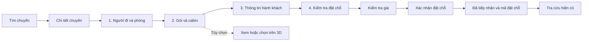

# UI Contract — Customer Booking Redesign

## Hành trình và route

| Route | Vai trò mới | Tương thích |
|---|---|---|
| /cruises | Tìm chuyến theo filter/page thật; card rõ dữ liệu | Giữ query/paging hiện hành, không giả filter date/price/destination |
| /cruises/:cruiseId | Lịch trình, sale state, so sánh offer; CTA đặt chỗ | Giữ published projection và sale eligibility; CTA vào party |
| /booking/party | Bước 1: số người và nhóm ở chung | Route mới; tạo slot draft, không giữ chỗ hoặc áp giá |
| /booking/cabin-experience | Bước 2: gói/hạng/cabin, danh sách và mở 3D | Giữ URL cũ; không còn bắt buộc trải nghiệm 3D |
| /booking/travellers | Bước 3: cá nhân, liên hệ, payment plan hiện có | Giữ URL cũ; không thu tiền |
| /booking/review | Bước 4: kiểm tra giá, xác nhận, kết quả | Giữ URL; saved result hiển thị cùng boundary, không cần route chứa secret |
| /booking/lookup | Khôi phục/tra cứu ngoài scope | Giữ nguyên, không thay recovery redirects/auth |

Không dùng query step cũ để suy lại số thứ tự mới. Path cũ vẫn vào đúng ý nghĩa màn, guard có thể đưa về bước thiếu đầu tiên; bảo toàn cruiseId và from đã sanitize bằng catalogReturn. Khi hết in-memory draft, không render bước sau như đã complete. Không sửa Web Admin hoặc Mobile router.

## Bố cục và thao tác

- Discovery dùng bố cục public của OceVie; card không bịa giá “từ”. Chỉ cho booking CTA khi contract xác nhận được bán.
- Flow có một tiêu đề bước và một progress semantic /4, aria-current=step; không lặp PageHeader + hero banner + mô tả cùng ý hoặc giữ counter /03. Bước trước đã hợp lệ có thể mở để sửa; bước sau vẫn chạy guard.
- Desktop: nội dung chính + summary gọn của chuyến/nhóm/lựa chọn/giá đúng trạng thái. Mobile: một cột, summary có thể mở/thu; action không che input, lỗi hoặc browser safe-area. Không có ảnh trang trí lớn cạnh form.
- Bước 1 hiển thị nhóm/phòng rõ ràng và người trong nhóm. Chỉ thu thông tin cần cho phân nhóm; không đưa thêm loại tuổi/giá trẻ em nếu contract không có. Giảm số người/xóa nhóm có thay đổi cần bảo vệ, không xóa nhầm thông tin của người khác.
- Bước 2 hiển thị offer/hạng và quyền lợi thật; phân biệt chọn cabin cụ thể với giữ chỗ theo hạng. Offer vẫn theo passenger. Khách có thể áp một lựa chọn cho những người họ chọn nhưng hệ thống không tự đồng nhất cả nhóm.
- Cabin list hiển thị số cabin, boong, hạng, chỗ phù hợp và accessibility nếu dữ liệu có; filter chỉ trên tập đủ điều kiện. Radio/card semantic thay bảng Admin. Không hiển thị giá cộng thêm cabin ở nhánh fare đã gồm quyền cabin.
- 3D mở trong Modal hiện có bằng CTA rõ; đóng về đúng nút, giữ lựa chọn. Danh sách ở ngoài renderer vẫn thao tác được khi model không tải. Không gọi GLB/manifest hoặc mount renderer trước hành động mở trong giao dịch.
- Bước 3 dùng PassengerDetailsFields và quy tắc email đại diện guest hiện có; nhãn “Kế hoạch thanh toán” không gọi là đã thanh toán. Lỗi cạnh trường, summary và focus đầu tiên; ít subtext, không lộ mã nội bộ.
- Bước 4 hiển thị hành khách theo nhóm, các lựa chọn và payment plan. Ban đầu primary là Kiểm tra giá. Khi quote hợp lệ, primary là Xác nhận đặt chỗ; mọi thay đổi làm quote không khớp phải thu hồi xác nhận. Không thêm modal review lặp lại toàn trang.
- Nhãn trường tiền là Giá. Số tiền/đơn vị từ server phải đọc đúng, không đổi tiền tệ hoặc gán tổng bằng 0 khi chưa có quote.

## State, quyền và lỗi

| Tình huống | Hành vi bắt buộc |
|---|---|
| Không có kết quả / hết chỗ | Empty hoặc notice có hành động quay lại, không tạo lựa chọn giả |
| Loading / lỗi đọc availability | Giữ ngữ cảnh, Retry phần đọc, khóa lựa chọn cần dữ liệu chưa xác nhận |
| Offer hoặc nhóm thay đổi | Xác định lựa chọn nào còn hợp lệ; vô hiệu quote không khớp; không tự đổi gói hoặc silently reset toàn bộ draft |
| 3D đang tải / không có manifest / lỗi | Giữ danh sách độc lập và lựa chọn; Retry model theo thao tác khách; thông báo ngắn, không suy thành đã giữ cabin |
| Quote hết hạn | Không cho create; đường kiểm tra giá lại theo cơ chế hiện có, không đổi identity khi outcome chưa rõ |
| Đang quote/create | Một lock, busy/disabled và thông báo tiến trình; chặn double click |
| Quote unknown | Không tự yêu cầu quote mới khi không xác định kết quả; giữ recovery hiện có |
| Booking unknown | Giữ intent/identity, không tự POST lại; đường tra cứu/hỗ trợ hiện có |
| Đã tiếp nhận | Chỉ hiển thị khi decoder/readback xác nhận; reference + trạng thái actual + link lookup; không tự gọi paid/Confirmed |
| Reload | Không hứa khôi phục PII/intent; không tự gửi; quay về bước có đủ dữ liệu. Không suy lookup miss là chưa có booking để tự tạo lại |

Giữ guest access và authenticated access đang có; không thêm đăng nhập bắt buộc. Modal dùng Overlay/Primitives, Field/Button variants và canonical tokens; standard control 44px, CTA customer theo mapping hiện có (48px nếu variant hỗ trợ), radius control 6px. Không tạo primitive mới chỉ để khớp thiết kế.

## Traceability

| Yêu cầu | Nội dung / nghiệm thu |
|---|---|
| FR-001, FR-004 | Chỉ Booking public đến reference; lookup/Admin/Mobile regression và giới hạn scope |
| FR-002, FR-014 | Shared components/tokens, hierarchy/copy và kiểm tra ảnh desktop/mobile |
| FR-003, FR-006, FR-012 | Party stage, guard/map 4 bước, deep link, back/forward, giữ draft |
| FR-005, FR-009 | Gói theo người, grouping, inventory, quote và readback; api-preservation.md |
| FR-007 | Eligibility chung, list/3D synchronization, lỗi model không khóa list |
| FR-008, FR-013 | Field/error/empty/loading/focus, privacy của ảnh/log |
| FR-010, FR-011 | Review/quote/create, identity/expiry/known-vs-unknown, success receipt |
