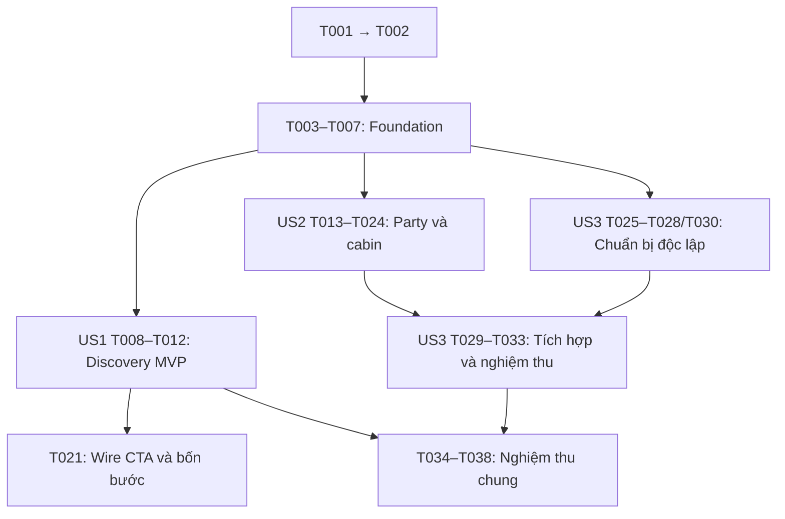

# Tasks — Customer Booking Redesign

**Input**: [spec.md](spec.md), [plan.md](plan.md), [research.md](research.md), [data-model.md](data-model.md), [UI contract](contracts/ui-flow.md), [API preservation](contracts/api-preservation.md), [validation guide](quickstart.md).

**Scope**: Customer Web Booking từ tìm chuyến tới mã đặt chỗ; bốn bước giao dịch; danh sách cabin độc lập và 3D tùy chọn. Giữ nghiệp vụ, guest access, APIs, USD, nhóm theo passenger và idempotency. Không sửa Backend, Web Admin, Mobile, payment processing hoặc lookup sau đặt chỗ. Không commit/push nếu chưa được yêu cầu cho feature này.

**Paths**: `CASMS_WebBooking/...` tính từ repo sibling `CASMS_Frontend`; `specs/...` tính từ `CASMS_Backend`. Tệp mới được chỉ rõ là tạo mới; tên file là đích triển khai, không chứng minh file đã tồn tại.

**Tests**: SC-001–SC-006 và acceptance scenarios yêu cầu kiểm chứng hành vi. Các task test bên dưới dùng toolchain/harness hiện có, không thêm dependency. Viết ca hành vi mới và xác nhận thất bại do feature chưa có trước phần implementation phụ thuộc; các ca bảo toàn baseline không cần cố ý làm thất bại. Mock chỉ chứng minh hành vi UI. Runtime thiếu fixture giữ mở và ghi rõ trong quickstart.md.

## Phase 1 — Setup

- [X] T001 Đọc AGENTS gốc/app, `design-systems/ocevie/DESIGN.md`, `design-systems/ocevie/tokens.css`, `CASMS_WebBooking/src/shared/ui/Primitives.tsx` và `CASMS_WebBooking/src/shared/ui/Overlay.tsx`; kiểm tra checkout/working diff, baseline typecheck/build/lint theo `CASMS_WebBooking/package.json`, ghi baseline và consumer dùng chung vào `specs/005-customer-booking-redesign/quickstart.md`. Bảo toàn local changes; không dùng demo booking-types.ts/VND làm live contract. (FR-001/002, SC-003)
- [X] T002 Xác nhận môi trường Backend/test DB được phép, fixture guest/authenticated nếu có, fare-managed/legacy, physical/category hold, một người/hai người/hai nhóm/mixed-offer, model hợp lệ/lỗi và quote/create recovery; đối chiếu `CASMS_WebBooking/src/features/booking/api/real-booking-api.ts`, `CASMS_WebBooking/src/domain/cruise-package/purchase-contract.ts`. Chọn và ghi lệnh chạy test bằng Node/TypeScript có sẵn và browser harness/Playwright từ môi trường; không thêm package hoặc sửa quyền/DB thật để vượt gate. Ghi matrix và các fixture/harness còn thiếu trong `specs/005-customer-booking-redesign/quickstart.md`. (FR-005/009/013, SC-001/002/005/006)

## Phase 2 — Foundation dùng chung

**Blocking checkpoint**: Một draft/controller, state sống qua route và stage helper được kiểm chứng. Không chuyển CTA sang party hoặc đổi router trước khi màn mới sẵn sàng ở T021.

- [X] T003 Tạo harness và test hành vi session tại `CASMS_WebBooking/tests/booking-redesign/session-contract.test.mjs` bằng runtime đã xác nhận ở T002: cùng intent giữ một key/lock qua route, quote unknown khác booking unknown, không POST do render và không lưu PII/token vào storage. Dùng Node assert và TypeScript/browser tooling hiện có; ghi cách chạy vào `specs/005-customer-booking-redesign/quickstart.md`, không thêm test library. Ca ownership mới phải bắt được lỗi mất state khi unmount trước T004. (FR-011/013, SC-002)
- [X] T004 Mở rộng `CASMS_WebBooking/src/features/booking/model/live-booking-context.ts`, `CASMS_WebBooking/src/features/booking/components/BookingProvider.tsx` và chuyển ownership tương ứng khỏi `CASMS_WebBooking/src/features/booking/pages/RealBookingCreatePage.tsx`: draft/saved/quote intent/quoteUnknown/booking uncertainty/submission lock nằm trong một boundary, không có store thứ hai. Giữ nguyên `quoteSelection`, request/create functions và quy tắc “Một identity cho cùng ý định gửi; readback/expiry/policy/total và từng line phải khớp”; in-memory only, không hứa phục hồi xuyên reload. Chạy T003 sau thay đổi, giữ ba route đang hoạt động cho đến T021. (FR-009/011/013, SC-002/005)
- [X] T005 Bổ sung định nghĩa bốn stage và hàm xác định bước thiếu đầu tiên tại `CASMS_WebBooking/src/features/booking/model/live-booking-navigation.ts`, `CASMS_WebBooking/src/features/booking/model/booking-progress.ts`; thêm ca deep-link/query vào `CASMS_WebBooking/tests/booking-redesign/navigation.test.mjs` trước sửa helper. Giữ `cruiseId`, `catalogReturn(from)` và backward navigation; tách số bước UI mới khỏi mode validator cũ 1/2/3, giữ entry point cũ tương thích, chưa wire router mới. (FR-003/006/012, SC-001/002)
- [X] T006 [P] Tạo composition `CASMS_WebBooking/src/features/booking/components/BookingJourneyProgress.tsx` dùng semantic ol/link, aria-current=step, nhãn/trạng thái nhận qua props và primitive/token hiện có; hỗ trợ heading/focus điều khiển từ flow, không hardcode /03 và không tự bỏ qua guard bằng cách click stage. Không đổi consumer hoặc tạo Button/Field/Modal mới ở task này. (FR-002/006/014, SC-003/004)
- [X] T007 Kiểm chứng foundation bằng `CASMS_WebBooking/tests/booking-redesign/session-contract.test.mjs` và `CASMS_WebBooking/tests/booking-redesign/navigation.test.mjs`, smoke ba route cũ/chọn phòng/nhập khách/review khi router chưa đổi; đối chiếu payload với `specs/005-customer-booking-redesign/contracts/api-preservation.md`, ghi kết quả vào `specs/005-customer-booking-redesign/quickstart.md`. Chỉ mở story work khi các guard cũ không bị mất. (FR-005/011/012, SC-001/002/005)

## Phase 3 — US1 · Tìm và chọn chuyến phù hợp (P1, discovery MVP)

**Goal**: Khách hiểu chuyến, lịch trình và lựa chọn đang được bán trước khi điền dữ liệu.

**Independent Test**: Dùng chuyến có/không đủ điều kiện bán, kiểm tra list/type/page, detail/offer/loading/empty/error và CTA. Trong MVP US1, CTA vẫn dùng entry đang hoạt động; T021 sẽ chuyển sang party cùng lúc có đủ màn/guard. US1 không cần tạo booking để chứng minh giá trị.

- [X] T008 [US1] Tạo `CASMS_WebBooking/tests/booking-redesign/discovery.test.mjs`: public type/page đúng request, không filter giá/ngày/điểm đến giả trên một trang, detail sale/offer đúng, trạng thái loading/rỗng/lỗi, không dựng lead fare hoặc CTA đặt khi không hợp lệ. Thiết lập trước T009/T010 và gắn nhãn response fixture khi giả lập. (FR-004/005/008/009, SC-001/002/005)
- [X] T009 [P] [US1] Redesign phần tìm chuyến trong `CASMS_WebBooking/src/features/booking/components/LiveCruiseCatalog.tsx` theo `CASMS_WebBooking/src/features/booking/api/booking-api.ts`: thứ bậc kết quả, loại chuyến, phân trang, reset/filter đúng khả năng server. Giữ dữ liệu ảnh/chuyến đã có, không bịa tổng kết quả, giá từ hoặc tìm kiếm toàn bộ trên một page; chưa thay phần detail wiring. (FR-002/004/005/008/014, SC-001)
- [X] T010 [P] [US1] Redesign nội dung detail tại `CASMS_WebBooking/src/features/booking/components/PublicCruiseInformation.tsx` và `CASMS_WebBooking/src/features/booking/components/PublicCruisePackages.tsx`: facts/lịch trình/sale state, so sánh offer/giá và một CTA đúng eligibility. Giữ “Chỉ tiếp tục khi adapter xác nhận được bán; không dùng PUBLISHED như đủ điều kiện duy nhất” và “Theo từng passenger; lựa chọn phải nằm trong catalog hiện hành của chuyến”. Giữ entry CTA hiện tại đến T021. (FR-004/005/009/014, SC-001/005)
- [X] T011 [US1] Tích hợp hierarchy, một heading và trạng thái đọc của list/detail trong `CASMS_WebBooking/src/features/booking/components/LiveCruiseCatalog.tsx`, chỉnh `CASMS_WebBooking/src/features/booking/components/Booking.module.css` bằng token đã nối runtime. Giữ `CASMS_WebBooking/src/features/booking/pages/DiscoveryPages.tsx` là live entry, không thay PublicLayout/home hoặc auth recovery ngoài consumer cần thiết. (FR-002/008/014, SC-003/004)
- [ ] T012 [US1] Chạy `CASMS_WebBooking/tests/booking-redesign/discovery.test.mjs` và nghiệm thu list/detail bằng Backend thật trên fixture T002, gồm hết lựa chọn, query/page, title dài và 390px; đối chiếu thứ tự dữ liệu/eligibility/price từ server. Ghi loại evidence, thiếu fixture và kết quả US1 trong `specs/005-customer-booking-redesign/quickstart.md`. (SC-001/002/003/005)

## Phase 4 — US2 · Chọn phòng, gói và người ở chung (P1)

**Goal**: Tách người đi/nhóm khỏi chọn gói/cabin; chọn được bằng danh sách ngay cả khi không mở hoặc lỗi 3D; giữ đúng từng người và tài nguyên chung của nhóm.

**Independent Test**: Seed draft/fixture của một người, hai người chung cabin, hai nhóm và mixed-offer; không phụ thuộc discovery. Xác minh membership, CATEGORY_HOLD, inventory, list↔3D, deep link và quay lại bước trước mà không cần gửi booking.

- [X] T013 [US2] Tạo `CASMS_WebBooking/tests/booking-redesign/party-allocation.test.mjs` và `CASMS_WebBooking/tests/booking-redesign/cabin-selection.test.mjs`: identity khi thêm/xóa/chuyển người, cùng tài nguyên nhóm, mixed-offer intersection rỗng/không rỗng, category hold cabinId null, cabin ngoài mapping/thiếu capacity, chọn list không mở model và list↔3D. Ca mới thất bại trước T014/T015; không coi fixture UI là inventory Backend thật. (FR-005/006/007/009, SC-001/002/005/006)
- [X] T014 [P] [US2] Tạo helper UI projection tại `CASMS_WebBooking/src/features/booking/model/booking-party.ts`, dùng metadata trong `CASMS_WebBooking/src/features/booking/model/live-booking-context.ts`: stable person/group keys và membership, derive từ passengers[] một nguồn, không gửi UI fields. Giữ “Việc xóa thành viên phải giữ đúng định danh của người còn lại, không chuyển offer/giấy tờ sang người khác do đổi index” và “Mỗi nhóm cùng tài nguyên mode + cabinId hoặc mode + loại cabin”; không ép mọi người cùng offer, không tự chia nhóm qua nhiều cabin, không bỏ group key gây gộp nhóm. (FR-005/006/012, SC-001/005)
- [X] T015 [P] [US2] Tạo selector dùng chung tại `CASMS_WebBooking/src/features/booking/model/booking-cabin-selection.ts` từ contract trong `CASMS_WebBooking/src/features/booking/api/real-booking-api.ts` và `CASMS_WebBooking/src/domain/cruise-package/purchase-contract.ts`. Giữ “Không đoán thuộc tính thiếu; dùng đúng filter của offer và capacity hiện hành”; PHYSICAL_CABIN thuộc physicalCabinIds, fare-managed yêu cầu remainingCapacity === capacity rồi xét phân bổ draft/capacity nhóm; mixed-offer dùng giao tập. Giữ “CATEGORY_HOLD: cabinId gửi null, chưa có cabin vật lý; chỉ server quyết định khả năng giữ hạng cho nguyên nhóm” và nhánh legacy/tourPackageId hiện có, không trộn vào fare. (FR-005/007/009, SC-002/005/006)
- [X] T016 [P] [US2] Tạo `CASMS_WebBooking/src/features/booking/components/BookingPartyStep.tsx` dùng helper T014: thêm/bớt người từng thao tác, nhóm Phòng 1/2 và gán người rõ ràng, sửa membership có bảo vệ dữ liệu đã nhập. Không yêu cầu PII ở bước phân nhóm, không thêm phân loại tuổi/giá hoặc max người tùy ý, không tự bulk cấp phát vô hạn hoặc thông báo đã giữ chỗ. (FR-003/005/006/009, SC-001/002)
- [X] T017 [US2] Refine `CASMS_WebBooking/src/features/booking/components/CruisePackageCabinSelection.tsx` thành phần chọn offer/hạng/mode theo người và nhóm, dùng T014/T015; cho phép khách áp lựa chọn cho đúng các thành viên họ chọn, không đồng nhất offer ngầm. Hiện lựa chọn còn hợp lệ và lỗi phần bị ảnh hưởng khi đổi nhóm/offer; không tính giá/phòng hoặc cộng cabin vào fare. (FR-005/006/007/009, SC-001/002/005)
- [X] T018 [P] [US2] Tạo `CASMS_WebBooking/src/features/booking/components/BookingCabinChoices.tsx` với radio/card/list độc lập model, nhận candidates/selectedCabinId/handler từ T015. Hiện số cabin, boong, hạng, capacity/accessibility khi có; không đoán thuộc tính null. Bộ lọc chỉ áp trên tập đã đủ điều kiện, và loading/empty/error không được suy thành cabin còn chỗ. (FR-002/007/008/009, SC-003/004/006)
- [X] T019 [US2] Gắn list và 3D vào cùng handler/state trong `CASMS_WebBooking/src/features/booking/components/CruisePackageCabinSelection.tsx`, `CASMS_WebBooking/src/features/booking/components/BookingShipModel.tsx`, giữ interface `CASMS_WebBooking/src/features/booking/components/BookingModelIntegration.tsx` và renderer composition `CASMS_WebBooking/src/app/CustomerShipPages.tsx`. Chỉ mount model sau Mở 3D; Modal hỗ trợ focus/Escape, lỗi/missing manifest không khóa list; không thêm viewer/import engine hoặc nới eligibility. (FR-007/008, SC-004/006)
- [X] T020 [P] [US2] Tạo `CASMS_WebBooking/src/features/booking/components/BookingFlowLayout.tsx` dùng BookingJourneyProgress T006; chỉnh `CASMS_WebBooking/src/features/booking/components/BookingExperience.tsx` để bỏ /03 cố định, ảnh trang trí và heading/subtext lặp. Layout có một heading, summary đúng dữ liệu và back/next theo props/guard; không tự tạo giá tổng hay POST ở presentation. (FR-002/003/006/014, SC-003/004)
- [X] T021 [US2] Wire bốn stage nguyên tử trong `CASMS_WebBooking/src/app/router.tsx`, `CASMS_WebBooking/src/features/booking/pages/FlowPages.tsx`, `CASMS_WebBooking/src/features/booking/pages/RealBookingCreatePage.tsx`, `CASMS_WebBooking/src/features/booking/index.ts` và CTA ở `CASMS_WebBooking/src/features/booking/components/PublicCruiseInformation.tsx`. Thêm /booking/party, giữ cabin-experience/travellers/review với ý nghĩa mới, dùng guard T005; map explicit từng stage sang validator mode cũ, không đổi enum 1/2/3 máy móc. Bảo toàn cruiseId/from đã sanitize, stage còn lại dùng presentation cũ qua adapter cho đến US3, không tạo route cụt. (FR-003/006/012, SC-001/002)
- [X] T022 [US2] Hoàn thiện responsive/focus/control/summary cho bước party/allocation và progress bằng `CASMS_WebBooking/src/features/booking/components/LiveBooking.module.css`, scoped `CASMS_WebBooking/src/features/booking/components/BookingParty.module.css` nếu cần tạo mới. Dùng token hiện có: control 44px, radius 6px, CTA theo mapping customer; mobile một cột, summary không che field/CTA, không copy bảng Admin hoặc tạo primitive. (FR-002/006/014, SC-003/004)
- [X] T023 [US2] Hoàn thiện invalidation và bảo vệ bản nhập trong `CASMS_WebBooking/src/features/booking/model/booking-party.ts`, `CASMS_WebBooking/src/features/booking/model/booking-progress.ts`, `CASMS_WebBooking/src/features/booking/components/CruisePackageCabinSelection.tsx`: giữ dữ liệu người/lựa chọn còn hợp lệ khi back/edit, tập cabin rỗng yêu cầu điều chỉnh có chủ đích; lỗi gắn trường/summary/focus. Structural selection/order/group change thu hồi quote thông qua controller, không tự đổi gói, reset toàn draft hoặc mất unknown guard. (FR-005/006/008/011/012, SC-001/002/004)
- [ ] T024 [US2] Chạy hai test T013 và nghiệm thu tại `specs/005-customer-booking-redesign/quickstart.md`: fixture thật cho physical/category hold/mixed-offer/multi-group nếu có; browser kiểm tra shared selection, model lỗi, không GLB/manifest trước Mở 3D, modal focus và deep link. Không lưu thay đổi PII/secret trong ảnh/log. Chưa đủ fixture hoặc chưa chứng minh điều kiện cabin thì giữ task này mở. (SC-001/002/003/004/005/006)

## Phase 5 — US3 · Điền thông tin và xác nhận đặt chỗ (P1)

**Goal**: Khách nhập thông tin đúng người, nhận quote thật rồi xác nhận một lần, thấy reference/status đúng; lỗi/unknown không tạo success giả hoặc mất draft.

**Independent Test**: Dùng draft allocation hợp lệ seed sẵn (không cần click lại US1/US2), test form cá nhân/payment, quote→readback→create và receipt; inject error/expiry/unknown riêng. Nghiệm thu E2E toàn hành trình vẫn chạy sau khi tích hợp cả ba story.

- [X] T025 [US3] Tạo `CASMS_WebBooking/tests/booking-redesign/transaction.test.mjs`: guest/contact validation, quote ready/expired/selection-changed, known rejection, quote unknown khác booking unknown, route change giữ lock, double click cùng intent/key, draft và actual status sau response. Thêm kiểm tra request/readback không lộ secret/PII và quote không bị cộng cabin lần hai. Viết trước T026–T030 bằng fixture rõ ràng; giữ ca Backend thật cho T033. (FR-005/008/009/010/011/013, SC-002/004/005)
- [X] T026 [P] [US3] Refine form trong `CASMS_WebBooking/src/features/booking/components/LiveBookingFields.tsx`, tái sử dụng `CASMS_WebBooking/src/features/booking/api/real-booking-api.ts`: “Giữ validation tên 2–100, email/phone, ngày sinh, giấy tờ trùng và các ràng buộc hiện hành; guest cần email đại diện theo guard hiện có”. Ánh xạ lỗi đúng stable person/index sau thay nhóm; Field/summary/focus, không thêm account login bắt buộc hoặc đổi optional/required. Giữ “USD; FULL/DEPOSIT/STAGES; notes tối đa 500; giữ serializer hiện có”, chọn payment plan không là thu tiền. (FR-005/008/010/013, SC-001/002/004)
- [X] T027 [P] [US3] Tạo helper chuyển trạng thái `CASMS_WebBooking/src/features/booking/model/booking-transaction.ts` và tích hợp vào context/provider `CASMS_WebBooking/src/features/booking/model/live-booking-context.ts`, `CASMS_WebBooking/src/features/booking/components/BookingProvider.tsx`. Dùng quoteSelection/classifier hiện có, hoist state ở T004 không tạo store mới; đổi cruise/payment/passenger order/offer/revision/mode/group/cabin hoặc hết hạn thu hồi quote, sửa PII vẫn validate cuối nhưng không bịa signature giá. Giữ “Một identity cho cùng ý định gửi; readback/expiry/policy/total và từng line phải khớp”. Pending/unknown không bị xóa bởi route unmount. (FR-005/009/011/013, SC-002/005)
- [X] T028 [P] [US3] Tạo `CASMS_WebBooking/src/features/booking/components/BookingReviewStep.tsx`: review theo người/nhóm, đúng lựa chọn và payment plan; chưa quote dùng Kiểm tra giá, quote hợp lệ mới Xác nhận đặt chỗ. Dùng giá/tổng đã xác nhận, label Giá, không tự tính room price, không nhân/cộng cabin thêm vào fare. Back/edit mở đúng phần, không lặp cả trang trong modal xác nhận thứ hai. (FR-006/009/010/014, SC-001/003/005)
- [X] T029 [US3] Tích hợp traveller/review/transaction vào `CASMS_WebBooking/src/features/booking/pages/RealBookingCreatePage.tsx` và `CASMS_WebBooking/src/features/booking/pages/FlowPages.tsx` bằng controller T027 và `CASMS_WebBooking/src/features/booking/api/booking-quote-api.ts` hiện có. Quote và create chỉ do hành động khách, giữ readback/fingerprint/policy/expiry/line checks/guest token và Idempotency-Key; chặn mutation lặp, không UUID mới để vượt unknown/lock, không đổi endpoint/payload hoặc status. Hiện known error và recovery quote/booking unknown riêng; reload không tự POST hoặc hứa khôi phục PII/identity. (FR-004/005/008/009/010/011/012/013, SC-002/005)
- [X] T030 [P] [US3] Tạo `CASMS_WebBooking/src/features/booking/components/BookingReceipt.tsx` dùng dữ liệu/formatters của `CASMS_WebBooking/src/features/booking/components/PublicBookingRecord.tsx`, `CASMS_WebBooking/src/features/booking/model/real-booking-view.ts` và `CASMS_WebBooking/src/features/booking/model/booking-presentation.ts`; receipt chỉ hiện sau decoder/guard xác nhận, có reference, trạng thái actual, số tiền/kế hoạch hiện có và link /booking/lookup. Giữ “Reference chỉ chứng minh đã tiếp nhận; không đồng nhất payment/contract/booking status”; không kéo workspace sau đặt chỗ vào redesign hoặc hiển thị đã thanh toán/Confirmed mặc định. (FR-004/009/010, SC-005)
- [X] T031 [US3] Gắn receipt vào /booking/review sau create hợp lệ trong `CASMS_WebBooking/src/features/booking/pages/RealBookingCreatePage.tsx`, hoàn thiện `CASMS_WebBooking/src/features/booking/components/LiveBooking.module.css` cho traveller/review/receipt/error/unknown. Giữ một primary theo state, dữ liệu đọc được ở mobile, bảo vệ draft và busy, không reset khóa để làm nút hoạt động. (FR-002/006/008/010/011/014, SC-003/004)
- [X] T032 [US3] Chạy và bổ sung regression contract trong `CASMS_WebBooking/tests/booking-redesign/transaction.test.mjs` đối chiếu `CASMS_WebBooking/src/features/booking/api/booking-quote-api.ts`, `CASMS_WebBooking/src/features/booking/api/real-booking-api.ts` và `CASMS_WebBooking/src/domain/cruise-package/api.ts`: payload không chứa UI metadata, quote không có PII; headers/identity/expiry readback giữ nguyên; legacy ghép GET /cruise/:id/packages với GET /servicepackage/packages ACTIVE/currency; không dùng TourPackage ở fare-managed branch. Không log raw token, key hoặc hồ sơ thật. (FR-005/009/010/011/013, SC-002/005)
- [ ] T033 [US3] Nghiệm thu guest và authenticated nếu có fixture, một người/nhóm/mixed-offer/legacy hợp lệ theo `specs/005-customer-booking-redesign/quickstart.md`: quote/readback/create/readback Backend thật; đối chiếu reference/cruise/currency/agreedFareAmount và đúng từng người. Lỗi/expiry/unknown UI gắn nhãn mock khi dùng fixture; không dùng mock success để đóng E2E, không ghi lên DB production. (SC-001/002/004/005)

## Phase 6 — Polish và nghiệm thu chung

- [X] T034 Kiểm tra keyboard, focus đầu lỗi/return focus, aria-current, field-label/error association, radio/card choices và modal 3D tại `CASMS_WebBooking/src/features/booking/components/BookingJourneyProgress.tsx`, `CASMS_WebBooking/src/features/booking/components/BookingCabinChoices.tsx`, `CASMS_WebBooking/src/features/booking/components/LiveBookingFields.tsx` và các step mới; sửa trong consumer trước khi mở rộng primitive. Ghi evidence SC-004 trong `specs/005-customer-booking-redesign/quickstart.md`. (FR-002/007/008, SC-004/006)
- [X] T035 Nghiệm thu toàn bộ list/detail/party/allocation/travellers/review/receipt và modal 3D tại 1366x900, 390x844, native browser zoom 200% và reduced motion theo `specs/005-customer-booking-redesign/contracts/ui-flow.md`; đo control/radius/focus, kiểm tra title dài/nhóm nhiều người, CTA không che input, không tràn ngang toàn trang. Lưu ảnh đã che thông tin nhạy cảm và chỉ sửa CSS consumer liên quan trong `CASMS_WebBooking/src/features/booking/components/Booking.module.css`, `CASMS_WebBooking/src/features/booking/components/LiveBooking.module.css`/scoped styles; ghi kết quả vào `specs/005-customer-booking-redesign/quickstart.md`. (FR-002/008/013/014, SC-003/004)
- [X] T036 Kiểm tra hồi quy `CASMS_WebBooking/src/app/CustomerRecoveryRedirect.tsx`, `CASMS_WebBooking/src/app/layouts/PublicLayout.tsx`, `CASMS_WebBooking/src/app/CustomerShipPages.tsx`: lookup/recovery giữ nguyên, home/public header/ships explorer không hỏng, guest không bị chuyển staff login. Rà consumer khi diff shared mở rộng; chứng minh source Backend/Admin/Mobile, API/permission và durable PII storage không đổi trong `specs/005-customer-booking-redesign/quickstart.md`. (FR-001/004/005/012/013)
- [X] T037 Chạy typecheck/build và lint đúng các tệp đổi theo `CASMS_WebBooking/package.json`; rà diff API/serializer/route/query, không secret trong artifact và không dependency/primitive mới ngoài plan. Đối chiếu tất cả FR-001–FR-014 và SC-001–SC-006 với test/evidence đã ghi tại `specs/005-customer-booking-redesign/quickstart.md`, không đóng ca thiếu fixture/runtime hoặc lỗi baseline chưa xử lý. (FR-001/005/011/012/013, SC-001–SC-006)
- [X] T038 Cập nhật trạng thái thực thi trong `specs/005-customer-booking-redesign/quickstart.md` và `specs/005-customer-booking-redesign/tasks.md`: phân biệt source review, automated/mock, runtime Backend thật và visual; đánh dấu chỉ task đã đạt, ghi baseline/gap/giới hạn reload và phạm vi sau đặt chỗ không redesign. Xác nhận Constitution gates trong `specs/005-customer-booking-redesign/plan.md`; không commit/push hoặc tuyên bố hoàn tất toàn bộ nếu còn gate mở.

## Dependencies và thứ tự thực hiện

### Phase/story graph

T021 thuộc US2, là điểm tích hợp sau phần US1 sửa PublicCruiseInformation và sau T016–T020. Không đợi T024 để chạy T021; T024 nghiệm thu US2 sau wiring. Hình US2 → US3I nghĩa là cần output selection/guard đã wire, không cấm chuẩn bị test/presentation US3 bằng seed draft trước đó.

### Phụ thuộc chi tiết

- T001 → T002; T003 → T004; T005 cần T004 contract ổn định; T006 độc lập sau setup. T007 chờ T004/T005/T006. Mọi story cần T007.
- US1: T008 trước T009/T010; hai task này độc lập tệp; T011 chờ cả hai, T012 sau T011.
- US2: T013 trước T014/T015. T016 cần T014; T017 cần T014/T015; T018 cần T015. T019 chờ T017/T018. T020 cần T006 và props stage đã chốt, không sửa controller. T021 chờ T005/T010/T011 và T016–T020. T022/T023 sau T021; T024 chờ T022/T023 và test T013.
- US3: T025 trước T026/T027/T028/T030. T026/T027/T028/T030 độc lập tệp; T029 chờ T021/T023 và T026/T027/T028; T031 chờ T029/T030; T032 sau T031; T033 chờ test T025/T032 và T024.
- T034–T038 sau T012/T024/T033. T035 sau các sửa a11y T034; T036 sau T035; T037 sau các sửa cuối; T038 chốt evidence và task status.

### Quy tắc song song

[P] chỉ là cơ hội làm trên tệp khác nhau khi prerequisites đã xong, không bắt buộc tạo agent. Chỉ chạy một writer cho file/controller/CSS/evidence tại một thời điểm. Không mutation đồng thời trên cùng record test. Không chạy cả story song song khi cùng sửa RealBookingCreatePage, Provider, PublicCruiseInformation hoặc LiveBooking.module.css.

- Foundation: T006 có thể làm trong lúc T003/T004/T005 xử lý session và guard.
- US1: sau T008, T009 (list) và T010 (public detail components) có thể làm song song; T011 tích hợp sau đó.
- US2: sau T013, T014 (party model) và T015 (cabin selector) có thể làm song song. Khi đủ helper, T016 (party) và T018 (list) độc lập; T020 (flow shell) không đụng controller/selector và có thể chuẩn bị cùng lúc. Không song song T017/T019 vì cùng CruisePackageCabinSelection.tsx.
- US3: sau T025, T026 (personal fields), T027 (transaction state), T028 (review UI) và T030 (receipt) có thể làm song song. T029/T031 tích hợp tuần tự, T032/T033 kiểm chứng sau tích hợp.

## Implementation strategy

1. Setup/foundation trước, bảo toàn current three-route flow trong quá trình chuyển đổi.
2. **Discovery MVP** là US1: list/detail rõ dữ liệu, sale gate thật, CTA vào flow hiện có. Có thể demo riêng; không gọi đây là Booking redesign E2E hoàn chỉnh.
3. US2 thay flow nguyên tử sang bốn bước và chọn cabin list + optional 3D. Kiểm chứng bằng draft seed độc lập; không tạo booking chỉ để test selection.
4. US3 nối thông tin cá nhân/payment plan/review/quote/create/receipt theo contract và chạy E2E thật. Không bịa API hoặc thay quy tắc để gỡ blocker.
5. Chốt cross-cutting evidence, mọi task thiếu dữ liệu/fixture vẫn mở. Không deploy/commit/push nếu chưa có yêu cầu tương ứng.

## Coverage và số lượng

| Hạng mục | Tasks | Số task |
|---|---|---|
| Setup | T001–T002 | 2 |
| Foundation | T003–T007 | 5 |
| US1 — Tìm/chọn chuyến | T008–T012 | 5 |
| US2 — Nhóm/gói/cabin | T013–T024 | 12 |
| US3 — Thông tin/quote/đặt chỗ | T025–T033 | 9 |
| Polish/acceptance | T034–T038 | 5 |
| Tổng | T001–T038 | 38 |

- FR-001/002: T001/T006/T011/T020/T022/T034–T038; FR-003/006/012: T005/T014/T016/T020/T021/T023/T036.
- FR-004: T008–T012/T029/T030/T036; FR-005/009: T002/T007/T010/T013–T019/T025–T033/T037.
- FR-007: T013/T015/T018/T019/T024/T034/T035; FR-008: T008/T011/T017/T018/T023/T025/T026/T029/T034/T035.
- FR-010/011: T003/T004/T025–T033/T037; FR-013: T002/T003/T004/T024/T025/T029/T032/T035–T038; FR-014: T006/T009–T011/T020/T022/T028/T031/T035.
- SC-001: T012/T024/T033; SC-002: T003/T007/T012/T024/T025/T032/T033; SC-003/004: T012/T024/T026/T031/T034/T035; SC-005: T007/T012/T024/T032/T033; SC-006: T013/T015/T018/T019/T024.

## Generation status

Chưa task nào được thực thi ở lượt sinh task. Không sửa source ứng dụng hoặc chạy test sản phẩm. Spec quality checklist không bị đổi. before/after tasks hooks được kiểm tra theo .specify/extensions.yml khi kết thúc lệnh; không có file thì không có hook cần chạy.

## Implementation evidence — 2026-11-08

35/38 task đạt. Không đánh dấu checklist requirements.md và không commit/push.

- T001/T002: baseline typecheck/build/lint đạt trước chỉnh code; kiểm tra token runtime, consumer, toolchain Node 24.22.0 và môi trường local. Tìm thấy PostgreSQL container, nhưng schema DB E2E chưa tương thích Backend hiện tại. Chi tiết tại quickstart.md.
- T003–T006: ca ownership mới thất bại trước hoist; navigation test thất bại trước helper mới. Sau thay đổi, test Node và browser xác nhận identity/unknown/lock qua route, không tự POST hoặc lưu PII/token.
- T008–T011: test discovery mới bắt được subtext lặp trước sửa; server paging/type, empty/error/sold-out và CTA được kiểm bằng adapter thật với response fixture.
- T013–T023: helper chưa có làm các ca mới thất bại, sau triển khai pass. Kiểm tra nhóm/identity/capacity/intersection, list↔renderer fixture, modal focus, dirty edit và guard bốn bước. Có ca hồi quy group key đầu tiên đổi khi gán cabin, đã sửa và kiểm chứng.
- T025–T032: test trạng thái mới thất bại trước helper; quote/create/readback, serializer, legacy ACTIVE links, expiry/unknown và double click đạt bằng fixture. Không coi đây là Backend E2E.
- T034–T038: keyboard radio/error/modal, desktop/mobile, native zoom 200%, token metrics, public shell/recovery và kiểm tra kỹ thuật đạt; các cổng thật vẫn mở dưới đây.

### Các task giữ mở

| Task | Phần còn thiếu | Nguyên nhân / điều kiện đóng |
|---|---|---|
| T012 | Nghiệm thu discovery với Backend thật | Backend local dừng ở schema validation; cần DB test tương thích rồi kiểm list/detail/paging/eligibility trên dữ liệu thật. |
| T024 | Physical/category hold/mixed-offer/multi-group và model published trên fixture thật | Browser/renderer mô phỏng đã đạt; chưa chứng minh inventory Backend hoặc GLB published thật. |
| T033 | Quote/readback/create/readback guest/authenticated thật | Backend không khởi động vì OnboardActivity thiếu catalog_entry; không tự migration/update schema để vượt gate. |

T007 bổ sung: browser-foundation-checkpoint.mjs PASS trên snapshot riêng tại target/feature005-foundation-checkpoint. Snapshot dựng từ Frontend HEAD 80b4cbf (router/màn ba bước), dùng implementation ownership Provider/context hiện tại và áp hoist quote vào controller cũ; helper transaction đi kèm để giữ một state owner. Chạy cabin-experience → travellers → review → quote modal, giữ category hold/USD/from query, 1 quote POST/0 create POST. Đây là kiểm chứng hồi quy checkpoint được dựng lại sau implementation, không phải khẳng định đã chạy browser trước khi đổi router trong worktree. Production worktree không bị revert/checkout.
